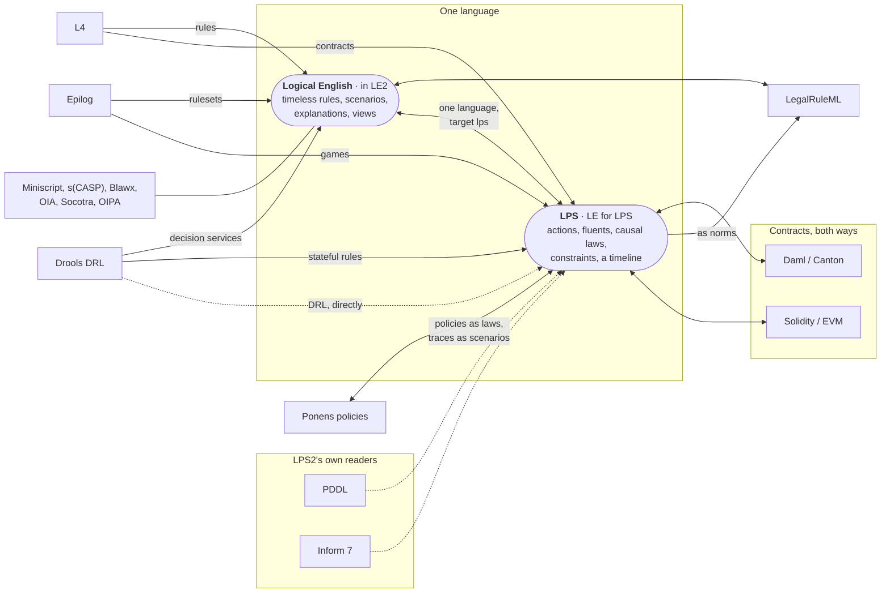

# Other systems and LPS

*Kind: integration guide · Audience: users · Status: current (2026-09-29)*

The IDE is the editor where you write and run programs. LPS stands for Logic
Production System. The IDE can open the programs of some other systems as LPS
programs. The IDE can also write an LPS program in the format of some other
systems. Each translation obeys fixed rules. A translation does not use a language
model. Each translation tells you what it could not translate. This page is the map.
The map shows the systems, the directions of translation, and what the menus of the
editor do with each system. Each system also has its own document. The links to these
documents are below.

Some translations are part of LPS2, and they are always available: PDDL, Drools DRL,
Inform 7 and Deploy as Solidity. Programs of the original LPS (LPS1) do not need a
translation. LPS1 writes its sentences in the same form as LPS2. Thus an LPS1 program
opens as an ordinary LPS program. The other systems go through Logical English. The
Logical English installation is adjacent to LPS2. A translator of that installation
changes the file into **Logical English for LPS**
(`the target language is: lps.`). These translators need LE2, the Logical English
editor, on this server (`LPS_LE2_LIB`, `LPS_LE2_URL` or `LPS_LE2_DIR`). They also need the Logical
English Translators, as on the hosted service. When the translators are not
available, the menus tell you.

## Contents

- [The map](#the-map)
- [The systems](#the-systems)
- [Opening another system's file](#opening-another-systems-file)
- [Seeing the original](#seeing-the-original)
- [Writing a program for another system](#writing-a-program-for-another-system)
- [See also](#see-also)

## The map

A plain arrow is a translation into LPS or into Logical English. A double arrow
means that the translation in the opposite direction also exists. A dotted arrow is
one of the readers of LPS2. A reader is a translator that is part of LPS2. The
documents for the systems on the Logical English side of the diagram are in the
Logical English editor, not here. Click a system to open its document.

## The systems

| System | Ways | Document |
|---|---|---|
| PDDL (planning domains and planning problems) | in | [PDDL](pddl.md) |
| Drools rule base (DRL) | in: the reader of LPS2 (File ▸ Open…), or the Logical English translator (its twins, and the LE editor) | [Drools](drools.md) |
| Inform 7 story | in | [Inform 7](inform-7.md), and the tutorial [LPS for Inform users](../tutorials/inform-users.md) |
| Solidity contract | in (through Logical English), out (**Deploy as Solidity…**) | [Solidity](solidity.md) |
| Daml (Canton) | in and out (through Logical English) | [Daml](daml.md) |
| L4 | in (through Logical English): the contracts go to LPS2, the rules go to LE2 | [L4](l4.md) |
| Ponens policies. A Ponens policy examines the record of the session of an AI agent. | in and out (through Logical English): each policy becomes a law that records a breach, and each trace becomes a scenario | [Ponens](ponens.md) |
| Epilog games | in (through Logical English) | [Epilog, in the LE2 documentation](https://le2.logicalcontracts.com/docs/user/integrations/epilog) |
| LegalRuleML | out, as norms (through Logical English) | [LegalRuleML, in the LE2 documentation](https://le2.logicalcontracts.com/docs/user/integrations/legalruleml) |
| Bitcoin Miniscript, s(CASP) and Prolog, Blawx, Oracle Intelligent Advisor, Socotra, OIPA | into Logical English (rules with no time), which the LE2 editor runs | [Other systems, in the LE2 documentation](https://le2.logicalcontracts.com/docs/user/integrations/index) |

## Opening another system's file

**File ▸ Open…** opens LPS programs (`.lps`, `.pl`, `.P`) and Logical English
programs (`.le`). The same menu item also opens the files of other systems, and
changes them into LPS when it opens them. These files are:

- a PDDL domain with its problem (`.pddl`)
- a Drools rule file (`.drl`, together with its `.wording`)
- an Inform 7 story (`.ni`)
- when the Logical English installation has the translators, the files of those
  translators (a Solidity contract `.sol`, a Daml source, a zipped project, and
  others).

Put the mouse pointer on the menu item. A tip then tells you which files this server
can change. Select all the files that go together at the same time. The editor makes
pairs of files with the same method as **File ▸ Open example from server…** and the
command line. The editor puts a problem with the domain that the problem names. The
editor puts a `.drl` with the `.wording` that has the same name. Each pair opens as
one program. The editor sends a `.zip` file to the server with no change, byte for
byte. The dialog of examples also shows the *migration twins*. Migration twins are
programs that a translator made from published Drools, Solidity, Daml and L4
sources. They are in the folder `migration/`. The dialog also shows the policy packs
of Ponens.

A file that goes through Logical English opens as a Logical English document for
LPS. The translator writes its notes in a comment at the top of the document. The
notes tell you what the translator encoded and what it could not translate. The
status line tells you to look at these notes. The parts that the translator could not
translate stay in the program. Each such part is a comment that starts with `% TODO`
or a `RESIDUE` block
([what could not be translated](https://le2.logicalcontracts.com/docs/user/integrations/index#what-could-not-be-translated)).

## Seeing the original

**View ▸ The original this was converted from** shows the file from which the editor
made the program. For a file that you opened in this session, the menu item shows
that file. For a program that you opened from the server, the menu item shows the
files in the `sources/` folder. This folder is adjacent to the program.

## Writing a program for another system

- **Misc ▸ Deploy as Solidity…** first examines the program. It finds if the
  program can become a Solidity contract. If the program cannot, the editor shows a
  list of the reasons. If the program can, the editor shows the contract. You can
  then copy the contract into the Remix online editor ([Solidity](solidity.md)).
- **Misc ▸ Export to another system…** writes a Logical English document in the
  format of a different system. It uses a writer of the Logical English installation.
  A Logical English for LPS document can go out as Daml or as LegalRuleML norms. A
  plain Logical English document can go out as LegalRuleML or as Miniscript. Possibly
  the other system cannot say correctly what the document says. In this case, the
  editor does not write the file. The editor shows a list of the problems, with the
  line of each problem.
- **Misc ▸ Deploy as WASM…** does not make a program for a different system.
  Deploy as WASM puts the program and the WebAssembly runtime of SWI-Prolog into one
  web page. WebAssembly (WASM) is a format that a browser can run. Thus the program
  runs as LPS in a browser.

## See also

- [Logical English for LPS](../reference/le-for-lps.md), [the language reference](../reference/lps.md), [using the editor](../guide/ide.md).
- [Introducing LPS2, part four: other languages, in and out](../overview/introducing-lps2.md#part-four--other-languages-in-and-out).
- In the Logical English IDE: [other systems: importing and exporting](https://le2.logicalcontracts.com/docs/user/integrations/index).
