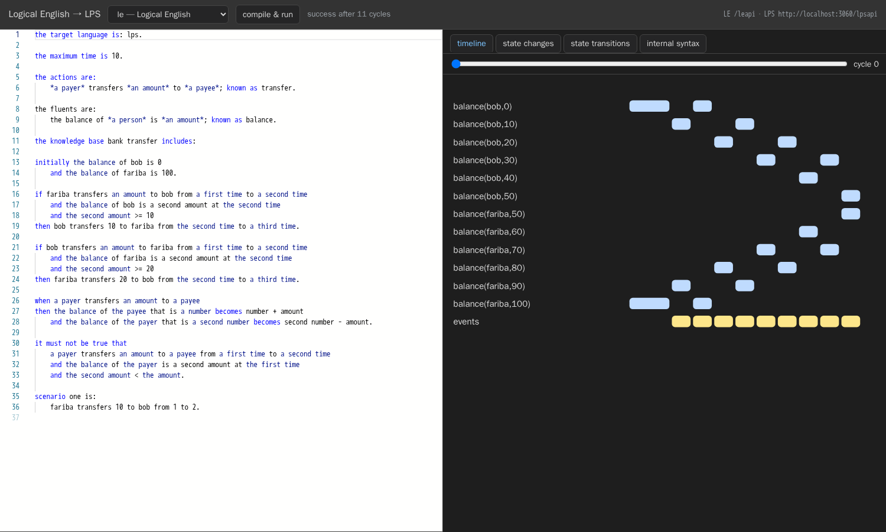

# LPS2 in detail

*Kind: overview (technical companion) · Audience: programmers, and readers who know LPS1 · Status: current (2026-09-26)*

[Introducing LPS2](introducing-lps2.md) is the tour for new users. It shows what
LPS2 (the second version of the Logic Production System) does while the system runs.
This document is the companion of the tour. It gives the details that the tour does
not give:

- how the engine was compared with LPS1, the original system;
- how the parts of the system are arranged;
- how each feature works inside;
- what the construction of the system taught.

Each section of this document tells which section of the tour it gives more
information about.

The [glossary](../reference/glossary.md) defines the terms. The development plan
is the [plan of record](../../project/plan-of-record.md). It includes all the parts
that do not exist yet.

---

## Contents

1. [When rules disagree: the selection specification](#1-when-rules-disagree-the-selection-specification)
2. [Why implement it again](#2-why-implement-it-again)
3. [What "behaves like LPS1" is taken to mean](#3-what-behaves-like-lps1-is-taken-to-mean)
4. [How the system is arranged, and what that buys](#4-how-the-system-is-arranged-and-what-that-buys)
5. [Differences from LPS1, in one table](#5-differences-from-lps1-in-one-table)
6. [Planning, explanations and sessions, inside](#6-planning-explanations-and-sessions-inside)
7. [The editor, inside](#7-the-editor-inside)
8. [The assistant, inside](#8-the-assistant-inside)
9. [The web interface](#9-the-web-interface)
10. [WebAssembly](#10-webassembly)
11. [Logical English, inside](#11-logical-english-inside)
12. [PDDL, inside](#12-pddl-inside)
13. [Drools, inside](#13-drools-inside)
14. [Minecraft: running the example](#14-minecraft-running-the-example)
15. [Industrial control: the named tools](#15-industrial-control-the-named-tools)
16. [Deploying it](#16-deploying-it)
17. [How it was built, and what that cost](#17-how-it-was-built-and-what-that-cost)
18. [Known gaps, in detail](#18-known-gaps-in-detail)

---

## 1. When rules disagree: the selection specification

*Gives more information about §2 of the tour.*

The really difficult part of an LPS engine is this: what occurs when several rules
want things that cannot all occur? LPS1 had an answer, and the answer is in the code
of LPS1. But nobody ever wrote the answer down. Without that answer, the instruction
"make LPS again" does not give sufficient information to do the task.

[`selection-spec.md`](../../dev/semantics/selection-spec.md) is that missing
document. It gives twenty numbered points where the engine must make a choice. The
points SP1 to SP15 came from a study of LPS1. The points SP16 to SP20 were found
during the construction of LPS2. Each point tells which choice the engine really
makes.

Here are two examples of the questions that the document answers. Both examples are
about the order of the steps in one cycle of the engine of LPS1. The specification
gives these steps numbers, and calls them phases.

**The step that seems to move the state forward does not do this.** LPS1 has a step
with the name `updateFluents`. But in the default mode of LPS1, the engine does not
do that step. The state moves forward in two later steps: `updateNextStateFluents`
and `copyNextState`. The first description of the cycle in the plan was different.
The specification records the correction.

**Phase 10 is one step, not three steps.** Three tasks occur together in this
phase:

- the engine accepts what was observed;
- it calculates the goals;
- it examines the preconditions of the selected actions. A precondition is a
  constraint that tells when an action must not occur.

The engine can go back and try a different route through any part of that phase.
Thus an action whose precondition fails at the *end* of the phase can send the engine
back to the *start* of the phase, where the observed events come in. That behaviour
is part of the meaning of the language (selection point SP11). It is not a detail of
the construction of the engine.

The document also marks each of the twenty points as *load-bearing* or
*incidental*. At the incidental points, a future engine can be different from LPS1.
The load-bearing points are what the recorded runs really test.

## 2. Why implement it again

*Gives more information about §3 of the tour.*

LPS1 has approximately 5,000 lines. It has `engine/interpreter.P`, `utils/psyntax.P`,
a table of the symbols of the notation, and a small store. LPS1 works. Its
collection of example programs contains the knowledge of what LPS is for.

But LPS1 also has all its parts in the same location. One file, `interpreter.P`,
contains all of these parts:

- the cycle;
- the part that calculates goals;
- the part that updates the state;
- the tests;
- the connections into SWISH, the web system that people used to run LPS1;
- the control of work that occurs in parallel;
- the server mechanism.

That file has the word "thread" 48 times. A thread is a sequence of work that runs at
the same time as other sequences of work. Most of these 48 are near the layer that
answers questions. The program does not change, but the session changes. Both are in
the same Prolog module. The system selects that module while it runs. Code gets to
the module through `u_call/1` and similar predicates.

This is not a criticism. A research engine that later received a web interface
always looks like that. But the same arrangement prevents four things in LPS: a
planner, a session that you can copy, a version that runs in a browser, and a second
way to write a program. All four come from one change: **keep the program separate
from the session, and keep the engine free of all other things.**

The sources of LPS2 were the plan, `selection-spec.md`, and observation of what LPS1
does. The intention was always to read `interpreter.P`. `interpreter.P` is the code
of the user. The plan treats the table of symbols and the internal words as stated
parts of the agreement between the two engines. But nobody copied LPS1 into the new
engine one line at a time. The part that calculates goals was written against the
twenty numbered rules. Thus the new engine keeps the accidents of LPS1 only where the
specification says that they are important.

## 3. What "behaves like LPS1" is taken to mean

*Gives more information about §4 of the tour.*

A recorded run is a file of Prolog facts: `lps_test_result(Stage, Cycle, Count)`
and `lps_test_result_item(Stage, Cycle, Term)`. The stage is `fluents`, `events` or
`composites`. Two runs are the same only if the number of items is exactly the same.
Then the test sorts the two sets of items and compares them. Only the names of the
variables can be different.

Thus the order of items *in* a cycle is not important. **The cycle of each item, the
number of items, and the shape of each term must all be exactly the same.**

These three conditions are much more difficult to satisfy than "the examples still
give sensible answers". A program can get the same answer by a different route. Such
a program fails the test.

| result | meaning | count |
|---|---|---:|
| a | the same after each change that the test makes on purpose | **99** |
| b | depends on a choice; needs a rule that is stated | 0 |
| c | is different when it runs again with no change | 0 |
| documented | the recording is old | 3 |
| documented | old, recorded in 2019 | 6 |
| **unexplained failure** | | **0** |

The changes on purpose were part of the tests from the start. They were not added
later. The tests run each program again in four more ways:

1. with its rules and facts in the opposite order;
2. with the list of initial fluents in the opposite order;
3. with new goals at the start of the waiting list, not at the end;
4. written again with no change, as a check of the check itself.

If the result of a test changes after one of these four changes, the test depends on
a choice. Such a choice must be *stated*. It must not stay an accident. No test
changes.

For each of the nine documented cases, `conformance/adjudicated.pl` gives the
evidence. Six of the nine are recordings from 2019, on SWI-Prolog 8.1.1. At that
time, LPS1 did not yet record `real_date_begin/1` as a composite event. LPS1 itself
fails those six now, and it gives exactly the same diagnosis as LPS2. One case
records ten cycles of a program that now declares `maxTime(8)`. One case was
recorded before somebody added a `maxRealTime` declaration. The last case is
`prospectiveGoat`. Its recording from 2017 has no `composites` records.

There is one more finding, about how LPS1 runs its own tests. **LPS1 compares only
the cycles that the run really made.** Thus, if a run stops in the middle, LPS1 gives
it a pass. The tests that this section describes make their own strict decision.
They also report the decision of LPS1 next to it. Two of the tests of LPS1 pass in
LPS1, but they do not examine some recorded cycles.

`--engine cross` runs the two engines and compares them with each other, not with
the recording. When a recording is older than the behaviour that it recorded, only
this direct comparison of the two engines has a meaning.

**Speed.** For the middle program of the collection, LPS2 uses approximately 0.4
times the clock time of LPS1. It uses one third to one half of the memory
(`tools/compare_engines.pl`). One program is slower: `prospectiveGoat2` takes 2.4
times as long. The reason is that it examines the look-ahead constraints again for
each action that it considers. To make it faster, it is necessary to arrange the
check differently. A change of that size needs its own run of the full test suite.
It must not be a quick change with a stopwatch. Thus the problem stays open.

## 4. How the system is arranged, and what that buys

*Gives more information about §3 of the tour.*

LPS2 has approximately 10,000 lines of SWI-Prolog in three layers. It also has the
editor that runs in the browser:

```
src/core/     the engine. No input or output, no threads, no clock, no C.  5,449 lines
src/syntax/   between the written forms and the internal form              1,681 lines
src/edges/    everything that touches the world: files, CLI, HTTP          3,314 lines
```

`tools/lint_core.pl` is the program that enforces the first of these three lines.
No code in `src/core/` can use any of these:

- threads;
- sockets (connections to other computers);
- HTTP, the method that requests use to go across the web;
- `process_create`, `shell` or `get_time`;
- predicates in the C language;
- random numbers;
- the reading and writing of files.

There is one exception on purpose: `b_setval` and `nb_setval`. Only one file uses
them. The first comment of that file explains why the engine needs these two.

That rule has a purpose. Four good results come from it.

**A session is a term that nothing ever changes.** Thus `lps_session_fork/2` makes a
copy in one step. The copy and the original are the same term with two names. The
plan had a design for a store in two halves, which copied the state only when
something wrote to it. That store was not necessary. A measurement shows that a copy
takes **approximately 5 microseconds, for each size of session**
(`tools/bench.pl`).

**Something outside the engine tells the engine the time. The engine never reads a
clock.** The outer edge of the system sets the speed of a session, for example two
cycles each second. One predicate in `src/edges/lps_live.pl` does that task. Thus a
session in real time and a usual run use the same engine, which does the same work.

**You can change all of the engine into WebAssembly** (§10). WebAssembly is a form
of program that a web browser can run. It took one day to put `src/core/` and
`src/syntax/` into one page that needs nothing more. The reason is that the half of
the system that touches the world was already separate.

**You can examine whether a run gives the same result each time.** The changes of
§3 are possible only because a run depends on the program, the options and the
observations, and on nothing more.

## 5. Differences from LPS1, in one table

| | LPS1 | LPS2 |
|---|---|---|
| **Language** | reactive rules, causal laws, constraints, composite events, intensional fluents | the same, and also `achieve` and `display3d/2` |
| **Planning** | goal reduction; `prospectively` to look ahead | `achieve`, with a breadth-first search or a greedy best-first search, or the system selects one of the two; a set of actions in each cycle; a new plan when a plan fails |
| **Explanation** | — | a record of how the engine got each conclusion, kept for each run; five types of question; four different answers to *why not* |
| **What if** | — | `lps_session_fork/2`, approximately 5 microseconds; `what_if` compares two runs |
| **Running without end** | yes, with real-time options | yes; events can also arrive over the network while the program runs, and each channel can send only some events; the system keeps only a limited history |
| **Errors** | Prolog errors | ordered reports with `src(File,Line,Col,Kind)`, which stay correct after the translation from Logical English |
| **2D animation** | paper.js, in SWISH | Konva, the same `display/2` words, the y axis in the correct direction, a library of pictures on the same computer, and shapes that you can click |
| **3D animation** | — | three.js, controlled by `display3d/2` |
| **State diagram** | `godfa/1`, one column | in layers; arrows that go in parallel become one arrow; a return to an earlier state shows as a loop; in the editor and on the command line |
| **Editor** | SWISH | Monaco: one set of colour rules for LPS and Prolog, made from the table of symbols of the engine; errors shown on their line; menus; a list of examples; you can change the size of each panel |
| **Assistant** | — | a language model, from one of five suppliers; its tools are the operations of the editor |
| **Ways in** | LPS syntax, `.lpsw`, lps.js | LPS syntax (the syntax of LPS1), the internal form, Logical English, PDDL, Drools, Inform 7; not the syntax of lps.js |
| **Ways to run it** | a SWISH server | the command line, one web address, a packaged image that is ready to run on a server, WebAssembly |
| **Keeping the engine self-contained** | not tried | examined by a program |

## 6. Planning, explanations and sessions, inside

*Gives more information about §5 to §9 of the tour.*

**Explanations.** `tools/explain_test.pl` has thirteen cases of the five types of
question: `why(happened(A),T)`, `why_not(happened(A),T)`, `why(holds(F),T)`,
`why(stopped(F),T)`, and `what_if(Events,T)`. The four answers to `why_not` are
`scheduled_for_another_cycle`, `no_goal_created`,
`rejected_by_prospective_constraint` and `no_plan_found`. In other cases, the
answer is "no applicable rule". When the record does not give the answer, the answer
is *not recorded*.

**What if.** `what_if(Events, T)` makes a copy of the session with
`lps_session_fork/2`. It continues the copy with the different observation. Then it
compares the two records in the same way as the tests compare a run with a
recording. It compares them by stage and by cycle, and only the names of the
variables can be different. Thus the answer to "what would have occurred?" uses the
same terms as a test that fails.

**The state-transition diagram.** `./lps automaton PROGRAM` prints the diagram. The
`automaton` operation of the web interface gives it back as JSON. JSON (JavaScript
Object Notation) is a text format for data, which a different program can read.

**Sessions that do not stop.** A loop that watches the clock sets the speed, in
`src/edges/lps_live.pl`. That is the only location in the system that reads the
clock to keep a *rate*. The engine keeps its own time of events, with no change. To
start a session, you give a list. For each source, the list tells which kinds of
event, named as predicates, the source can send:

```json
{ "llm":   ["task_request/2"],
  "human": ["approval/2", "task_request/2"] }
```

A live picture can send the mouse events `lps_mousedown/3`, `lps_mouseup/3` and
`lps_mousedrag/3`. The server decides which of these from the program itself: only
the events that the program declares. Thus nobody can open an animation to make an
event that is not permitted.

## 7. The editor, inside

*Gives more information about §10 and §11 of the tour.*

`./lps ide` serves the editor on port 3060, if you do not give a different port
(`--port`). A tool with the name esbuild makes the editor from the files in `ui/`.
It puts the result in `src/ide/dist/`. Node.js is necessary to make the editor, but
not to run it. The packaged image that serves the completed editor does not contain
Node.js.

**One set of colour rules** is for LPS and for the Prolog that you can write in an
LPS program. These rules use a table of symbols. A program *makes* this table from
the table of the engine (`tools/gen_monarch.pl`). Thus the editor always agrees with
the part of the system that reads a program. The editor gives fluents, events and
actions their colours from the declarations of the program. The same examination of
the program also gives completions while you type. `loc(wolf,north)` and
`row(south,north)` have exactly the same shape. Only the declarations tell which one
is a fluent.

The editor component, Monaco, has its own features: the right-click menu, find and
replace, folding (the hiding of a part of the text), and marks on the other
locations of a name. But you must ask for each of these features separately. The
simplest installation of Monaco on a page gives you none of them. For this reason,
an earlier version of this editor had a right-click menu that did nothing.

The timeline uses the records `stage(fluents, Cycle, Items)`. These are the same
records that the tests compare with the recordings of LPS1. Thus you do not have to
switch on a part of the engine before the timeline can show.

**There are two editors, on purpose.** `/LogicalEnglish2/editor/lps.html` is the
editor of LE2, the Logical English system. It has two languages and two servers.
`src/ide/` is the editor of this project. Both editors communicate only with
`/lpsapi`, the single web address of §9. This keeps the arrangement honest. You can
do all the things that either editor does with `curl`. `curl` is the usual
command-line tool that sends a request to a web address. Thus you can test all of
these things without an editor.

**The libraries for drawings.** There are 134 pictures. They come from OpenMoji
(CC BY-SA 4.0), game-icons.net (CC BY 3.0) and Material Symbols (Apache-2.0). The
selection came from a count of the predicates that the examples really use. This
project made the nineteen fills and the thirty-four three-dimensional objects. Thus
they need no licence and no attribution, and they cannot become unavailable.

`display3d/2` is a separate declaration. It is not a second reading of
`display/2`. Some properties have a meaning in two dimensions, but if you use them
in three dimensions, they do not show what the author meant. Also, a program can
have a good reason to have both drawings, and each drawing can show a different
thing. The types are `box`, `sphere`, `cylinder`, `cone`, `plane`, `ground`,
`line`, `arrow` and `text`, with `camera` and `light` in the
`display3d(timeless, …)` background.

## 8. The assistant, inside

*Gives more information about §12 of the tour.*

The assistant is a loop in Prolog. Its model is the loop of LE2. If the server has a
key, the assistant uses that key, not a key from the browser. Thus one person can
set one key for all users.

The tools of the assistant are the operations of the editor. The assistant calls
them in the same program that runs. It does not get them from a different location.
The tools are:

- `analyse`: change the program from its written form into the internal form that
  the engine runs, and report the errors;
- `run`: run the program and give back the record;
- `explain`: the questions of §6 of the tour;
- `scene`: what the drawing clauses really made.

A model can ask "does this program translate?". The model gets exactly the same
answer that the editor shows, because the model and the editor make the same call.

The suppliers themselves give the list of models. When the server starts,
`lps_models.pl` reads the catalogue of models of each supplier. It does that work in
parallel with all the other work. Thus a slow supplier cannot stop `./lps ide`. A
person keeps a table by hand in `lps_llm.pl`. The system uses that table when there
is no connection.

**The model does not write coordinates.** That is all of the design of *Animate in
2D* and *Animate in 3D*. When the model wrote coordinates, the result was as you
expect: positions that seem correct but are on top of each other. For example, three
animals were in the same location, and a label was outside the picture. Models know
that a goat is on a river bank. Models are bad at arithmetic about a picture. If you
tell a model to examine its own work, its arithmetic does not become better.

Thus the work has two parts.

  **First**, the model gives back a *plan*. The plan tells which containers there
  are, which things move between them, which fluent puts a thing in a container,
  and what each thing looks like.

  **Second**, `src/edges/lps_scene.pl` calculates the position of each thing. That
  program puts the boxes of the plan one after the other, in the same way as a web
  browser puts a row of items on a page. Boxes in such a layout cannot be on top of
  each other. A constraint solver is a program that finds an arrangement that
  satisfies a list of conditions. A constraint solver would be the correct tool if
  the model gave conditions about how things align. The model does not give such
  conditions. If you asked the model for them, the difficult part would go back to
  the model.

Several other systems use the same division to make diagrams. First, they describe
the arrangement. Then, they calculate the positions separately.

The result in your file is usual Prolog: a table of positions (`lps_slot/4`), a
background, and one `display/2` rule for each layer. Thus the program stays easy to
read and does not depend on other things. Nothing calls the assistant while the
program runs. Each container has the *same* grid. Thus a thing keeps its column in
each container. That grid makes the animation easy to read. If each container had its
own arrangement, the grid would not be there.

Before, *Animate in 3D* asked the model for `display3d/2` clauses with coordinates.
That is the one task that the plan must take away from the model, and in three
dimensions there is one more axis to get wrong. The results were all things at the
origin, or a camera in a wall. Now both buttons ask for one plan, and `lps_scene.pl`
draws that plan two times.

**Nobody asks the model what the engine already knows.** Before the model makes a
plan, the program *runs*. Then `lps_scene_focus/3` reads three things from the
record of that run:

- which fluents make the states of the run different;
- which cycles must have a picture;
- which states the run goes back to.

The question to the model contains all three, and the rule that the plan must
include each of them. If a plan does not include one of them, the system gives the
plan back with the name of the missing item. The system also reads from the program
which fluents are *derived*, and the order in which the rules use things. The model
does only the part that needs a model: which fluent has which shape, and what each
thing looks like.

In three dimensions, the pictures of *Split into scenes* are photographs. One drawing
engine makes each picture again.

## 9. The web interface

*Gives more information about §13 of the tour.*

The web interface is **one address**, `/lpsapi`. Each request has an `operation`
field. That field tells which task the server must do. The server can ask for a
token. It accepts requests from a page that a different site serves. There are
approximately thirty operations: `compile`, `session_new`, `observe`, `step`, `run`,
`state`, `fork`, `trace`, `dump`, `analyse`, `explain`, `timeline`, `changes`,
`scene`, `scene3d`, `automaton`, `example`, `list_examples`, the `live_*` family,
the `assistant_*` family, and `wasm_bundle`.

The use of one address, and not many addresses, is a decision. With one address, one
shape of `curl` command can control all of the interface. Also, with one address,
the two editors, the Minecraft bot and the demonstration of §20 of the tour all
communicate with exactly the same thing.

The Model Context Protocol is an agreed method to give tools to a language model. It
has its own document: [LPS over MCP](../api/mcp.md).

## 10. WebAssembly

*Gives more information about §14 of the tour.*

**Misc ▸ Deploy as WASM** makes one page. The page contains three things:

- swipl-wasm, which is SWI-Prolog compiled to WebAssembly;
- all of `src/core/` and `src/syntax/`, as Prolog text;
- your program.

The page does not contain the parts that touch the world: requests over the web, the
assistant, sessions that continue to run, and the connection to LE2. It cannot
contain them.

The only content of the demonstration is that the remaining half loads. It loads
because `tools/lint_core.pl` enforced that separation from the first milestone.
Nothing was arranged specially for the demonstration. You can also make all of the
editor as a static site, with no server:
[deploy-vercel.md](../../dev/deploy-vercel.md).

## 11. Logical English, inside

*Gives more information about §15 of the tour.*

The LogicalEnglish2 project changes Logical English into the LPS internal form.
Then it runs the result on this engine. The agreement between the two projects is in
[`le-lps-interface.md`](../../dev/le-lps-interface.md). LE2 has a link to that
document, not a copy of it.



The picture shows the editor of LE2. On the left, there is an English program. LE2
translates it, and LPS2 runs it. On the right, there is the timeline of this
project. The two servers communicate directly, with nothing between them. For this
reason, the web interface must accept requests from a page that a different site
serves.

**LE2 loaded into LPS2.** LE2 gives one module, `le_service.pl`, and LPS2 loads that
module into itself (`LPS_LE2_LIB=/path/to/LogicalEnglish2`). Thus the translation of
a document costs only a usual call in the program that runs, approximately 0.2
seconds. It does not cost the start of a second program. Because of this difference,
the editor can translate a `.le` file each time you push a key, not only when you
ask. No part of LPS2 loads LE2 when the system is built. Thus LE2 stays optional. If
LE2 is not there, and you open a `.le` file, the system tells you which setting you
must give.

The editor makes the colours for a `.le` tab when it starts. It uses the tables of
keywords of LE2 itself, not a copy of them. A copy would become incorrect for each
language other than English when either side changed. The completions come from the
templates of the document. Each completion has a label that tells its function.

You do not have to hope that the result is the same when LE2 runs in LPS2 and when
LE2 runs as a separate program. A test examines this. `tools/m8a_test.pl` runs the
programs in `examples/le/*.le` in both ways. The terms must be equal, and only the
names of the variables can be different. The information about the source of each
term must be the same, and the error messages must be the same.

**The internal form.** This is what LE2 makes from the bank transfer of §15 of the
tour:

```prolog
maxTime(10).
fluents([balance(A,B)]).
actions([transfer(A,B,C)]).
initial_state([balance(bob,0),balance(fariba,100)]).
observe([transfer(fariba,10,bob)],2).
updated(happens(transfer(A,B,C),D,E), balance(C,F), F-G, [G is F+B]).
updated(happens(transfer(A,B,C),D,E), balance(A,F), F-G, [G is F-B]).
reactive_rule([happens(transfer(fariba,A,bob),B,C), holds(balance(bob,D),C), D>=10],
              [happens(transfer(bob,10,fariba),C,E)]).
d_pre([happens(transfer(A,B,C),D,E), holds(balance(A,F),D), F<B]).
```

- `known as transfer` connects the English template to the name of the predicate.
- `when … then … becomes …` becomes `updated/4`. That is the same thing that an
  LPS author writes as `updates … to … in …`.
- `it must not be true that` becomes `d_pre/1`.
- `scenario one is` is `observe`.

**Each term remembers its source.** LE2 makes `t(Term, src(File,Line,Col,Kind))`,
and the `compile` operation accepts a list of sources that agrees with it. Each
error comes back with the file, the line and the column as separate items. Thus, if
the system finds an error in the internal form, it reports the error on the English
line that made it. `tools/m8a_test.pl` examines this in six cases. Two of them are
"an error lands on the `.le` line it came from" and "a `.le` file with no LE2 set up
is refused, not guessed at".

You can put a `.lps` file next to a `.le` file. Then the system translates the two
files together. You can use this method for the constructs that the English cannot
express.

**The other direction.** `le_lps_write.pl` writes the internal form back as Logical
English. 13 of the 15 test programs stay the same after the round trip: English,
internal form, English again, internal form again. Only the names of the variables
can be different. The reason for the two programs that change is known: the
English has no form for a fixed calendar date. *Say it in English* is
`nl_to_le` of LE2. It goes through the connection of this project to the language
models. Thus it uses the same keys and the same model as the assistant.

## 12. PDDL, inside

*Gives more information about §16 of the tour.*

The plan sets one rule for each way in: **write the checker before you write the
translator**. This project obeyed that rule here. `pddl_plan_valid/4` is a separate
checker, which uses the meaning of PDDL directly. It was written first. The test
gives the length of each plan next to the shortest known length for that problem:

```
domain                 problem         steps   opt     validation
blocks-domain          blocks-p1       6       6       valid
blocks-domain          blocks-p2       10      10      valid
blocks-domain          blocks-p3       6       6       valid
gripper-domain         gripper-p1      15      11      valid
gripper-domain         gripper-p2      23      -       valid
hanoi-domain           hanoi-p2        3       3       valid
hanoi-domain           hanoi-p1        7       7       valid
elevator-domain        elevator-p1     7       7       valid
elevator-domain        elevator-p2     4       4       valid
rover-domain           rover-p1        3       3       valid
rover-domain           rover-p2        7       7       valid
lights-domain          lights-p1       6       6       valid
lights-domain          lights-p2       3       3       valid
logistics-domain       logistics-p1    …still searching…
```

The planner solves thirteen of the fourteen problems, and the checker accepts these
thirteen plans. Twelve of the thirteen plans are the shortest possible. (`lights`
was added later. It tests negative goals, goals with "or", quantifiers, conditional
effects and types. Refer to [PDDL and LPS](../integrations/pddl.md).) Hanoi is
useful for this claim, because you can calculate 2ⁿ − 1 yourself. You do not have
to find it in a book.

Greedy best-first search finds valid plans that are not the shortest. On
`gripper-p1`, it finds 15 steps, but the shortest known plan has 11 steps. That is
exactly what greedy best-first search does. The logistics domain is worse: the
search continued after forty minutes. Both of these are findings about the planner,
not about the translation. That is the purpose of a way in with an independent
checker. LPS programs alone would not show either of these problems.

**The written form.** File ▸ Open gives the written form of LPS. It does not give
the internal form that the translator makes:

```prolog
'pick-up'(A) from T1 to T2 terminates ontable(A).
false 'pick-up'(A) from T1 to T2, not clear(A) at T1.
```

`src/syntax/lps_surface_write.pl` does the usual translation in the opposite
direction. It examines itself each time that something calls it. The program reads
back the text that it wrote. It sends that text through the same reader that the
other parts of the system use. Then it compares the result term by term. Only the
names of the variables can be different. If the round trip fails, the caller keeps
the internal form, and the system tells the caller why. A translated program with a
meaning that is different from what the translator said is worse than a program that
is not easy to read.

`tools/surface_test.pl` does that check on each translated example: 17 of 17. The
check found two real defects. One of them was a fluent in `gripper-domain.pddl` with
the name `at/2`. `at/2` is also the name of an operator.

## 13. Drools, inside

*Gives more information about §17 of the tour.*

`lps_drools.pl` is one of the two translators that the server loads from the private
lpsPlus project (`src/syntax/lps_plus.pl`). The translator reads DRL, the language
of Drools rules. It reads `declare` types, `when`/`then` rules, `insert`,
`retract`, `modify(){}` and `not` patterns. It makes reactive rules and causal laws.

In LPS, an action or an event is something that occurs in the world. It is not an
operation on a store of facts. Thus the translator reads each rule as a statement
about the world. The working memory of Drools (the facts that Drools has at that
moment) describes that world. These are the readings:

- An insert of a Fire is a fire that starts (`fire_starts(Room)`). A delete is the
  end of that fire.
- `modify(s) { setOn(true) }` is the sprinkler that turns on
  (`sprinkler_turns_on(Room)`). A field that is only true or false is a state of its
  own.
- A change to a different field is that field that gets its new value
  (`order_state_becomes(Id, shipped)`). This is `updated/4`, exactly the
  `updates … to … in …` of LPS.
- A rule that only inserts has a guard: a condition that the inserted fact is not
  true yet. The reason is that Drools starts such a rule one time, but LPS would
  start it in each cycle.
- If each fact gives the same value to a field, for example the name of an alarm,
  the translator does not use that field.
- A `fire-alarm.wording` file next to the DRL file gives the words and names that a
  person would select (`alarm_goes_on`).

When Drools and LPS do not agree, the translator tells you. It does not guess.
`salience` is the method of Drools to decide which rule wins. LPS has no such
method: LPS decides by constraint, not by priority. This engine cannot calculate a
Java expression in the conclusion of a rule. Thus the rule does the external action
`java_leaf(Rule)` in its place. (The engine can calculate a simple read of a field,
for example `$p.getName()`, and arithmetic on such values. For other expressions,
the translator removes the change. It never puts an invented constant in its
place.) The translator reports both of these as warnings. In the same way, it
reports each rule attribute that LPS has no equivalent for, for example
`agenda-group` or a timer. `no-loop` becomes a condition. `enabled false` removes
its rule. If the translator cannot translate a condition (`eval`, `forall`,
`collect`), it removes the rule, with a warning. It does not read the condition as
something different.

The translator reads the parts that LPS has as the same parts:

- `or` between patterns becomes one rule for each alternative. Drools also makes one
  subrule for each alternative.
- `accumulate` becomes an aggregate over the state, for example a total or a count.
- `insertLogical` is a fact that is true only while the facts that support it are
  true. It becomes an intensional fluent.

`migration/drools/lps_drools_test.pl` in lpsPlus runs eighteen sets of rules against
their expected behaviour. All eighteen pass. The same test also examines the
readings of eleven of the sets. Eight of the eighteen are the example rule bases.
Each of the other ten tests one construct. The three newest examples are a traffic
light as a state machine, insurance eligibility, and order shipping. An example
must find a defect before it becomes part of the tests, and order shipping found
one. In `retract(o)`, `o` is a variable that a pattern gave a value to. The
translator made an action with the name of the variable itself. An action with that
name did not stop a fluent. Thus the rule started again and again without end, and
the fact did not go away.

## 14. Minecraft: running the example

*Gives more information about §21 of the tour.*

**The two rates are different on purpose.** The game world moves in steps of 50
milliseconds, twenty steps each second. The LPS session does two cycles each second.
If the two rates were the same, the rate of the engine would be a property of the
game, not of the agent. Some things must have a reaction faster than one cycle, for
example falling, drowning, or a creeper two blocks away. These things are the task of
the controlling layer, and the controlling layer already does some of them.

| layer | what runs there | rate |
|---|---|---|
| **controller** | mineflayer and its path-finder: it walks, jumps, swings, prevents collisions, follows a path | 20 steps each second |
| **supervisor** | an LPS session: goals that stay in force, constraints, plans, explanations | 2 cycles each second |

**flying-squid** is a Minecraft server in JavaScript. The bot connects to that
server, and it does not have to sign in to any service:

```sh
cd examples/agents/minecraft
node world.mjs &                # a local server on port 25565
node bot.mjs --program safety.lps
```

```
[bot] spawned
[lps] safety.lps running as live3, one cycle every 500 ms
[lps→bot] place_torch
[lps→bot] place_torch
```

`prismarine-viewer` draws the map on the server, not in the browser. Thus it needs
the `canvas` module, which is in the C language. On macOS, Windows and usual Linux
systems, npm downloads a copy that is ready to use. If no such copy exists, the
module needs Cairo and Pango. `examples/agents/minecraft/DETAILS.md` tells which
packages to install. The bot loads the viewer only when somebody asks for it. Thus a
computer without the viewer still runs the agent, but it does not show the picture.

## 15. Industrial control: the named tools

*Gives more information about §22 of the tour.*

Part V of the plan gives the names of the tools for a demonstration:

- IEC 61131-3 Structured Text, as the language that LPS2 will write;
- MATIEC, to change Structured Text into C;
- Beremiz, as the editor;
- OpenPLC, a programmable logic controller in software, not in hardware, to run the
  result.

Because these tools have names, the first work in that direction starts from a known
target. It does not start from a survey. No code exists for any of it yet.

## 16. Deploying it

The packaged image is made in two stages. First, Node.js makes the editor from `ui/`
into `src/ide/dist/`. Then SWI-Prolog serves the engine, the web interface and the
editor on one port. The image that runs does not contain Node.js.

`fly.toml` and `buildPush.sh` put the image on a server.
[`deploy.md`](../../dev/deploy.md) tells how to run LPS2 together with LE2. One
browser must be able to get to the two servers. Thus the settings that let a page
from one site call the other site must be correct.

`LPS_TOKEN` sets the token (the secret word) that the web interface asks for.
`LPS_ORIGIN` limits which other sites can call the web interface. The server reads
the keys of the five suppliers from its own settings. A key in these settings has
priority over a key from a browser.

## 17. How it was built, and what that cost

Six practices did most of the work. Another project can also use these six
practices.

**First compare with the old engine, and accept nothing more until the comparison
passes.** The first work was not code, but the tests. These were the steps:

1. Run *LPS1* on all of its own examples.
2. Sort each example by whether its recorded run stays the same after the changes on
   purpose.
3. Write down the numbers.

No other work started until the new engine made those runs again.

That order of work is not comfortable. It gives several weeks with no result to
show. But because of that order, nobody had to ask whether a new feature broke the
meaning of the language.

**Write down what the old code selects.** A recorded run captures *the choice that
the engine of 2021 made by accident*. If you make that choice again without a name
for it, you copy it but you do not understand it. For this reason,
`selection-spec.md` exists. It has twenty numbered points, each marked load-bearing
or incidental. Five of them, SP16 to SP20, were found when the new engine failed a
test.

**Write the checker before the translator.** For PDDL, a separate plan checker was
written first. For Drools, the expected behaviour of each set of rules was written
first. If the only check of a translator is "the result looks like PDDL", nobody
examines the translator.

**Let a program enforce the rule about the arrangement of the system.**
`tools/lint_core.pl` runs before the system records each change. Nobody had to
remember to keep the engine free of all other things. If a change broke that rule,
the build stopped. Because of that rule, the change of the engine into WebAssembly
took one day, not a new version of the engine.

**Never guess when you can report.** If no LE2 is installed, the system refuses a
`.le` file. It does not give an approximate result. `salience` in a Drools file
becomes a warning. When the record does not support an explanation, the
explanation is "not recorded".

**Take the pictures from the system while it runs.** `tools/doc_shots.cjs` makes the
pictures of the tour and of the tutorial from a server that runs. That run fails if
the browser reports an error, or if a request fails. To take photographs of the
panes for the tour, it was necessary to look at them carefully. This found three real
defects in the interface: labels on top of each other on the timeline, a state
diagram that was cut at the edge, and a scene from the previous program that stayed
on the screen.

The last of the six practices is also true in general: **writing the documentation
is a test**. When §20 of the tour was written, a defect was found. `app.log`,
without quotation marks, was read as a compound term, not as a simple name. Thus the
demonstration reported a success that did not really occur.

## 18. Known gaps, in detail

*Gives more information about §23 of the tour.*

- **The 2D canvas uses the colours of the theme, but the programs of LPS1 do not
  know that.** Some programs expected a white background. For example, `burning.pl`
  sets black text with `fillColor:black`. Such a program is difficult to read on the
  dark background. A program cannot state its own background. To add a way to do
  this would be a change to the language, not a repair of the drawing. To solve the
  problem, change the theme.
- **`prospectiveGoat2` is 2.4 times slower than LPS1** (§3). All the other programs
  are faster.
- **PDDL plans are not always the shortest** on problems similar to gripper. The
  search for the logistics domain continued after forty minutes (§12). The planner
  causes this limit, not the translation. Thus `tools/pddl_test.pl` also does not
  stop.
- **Ways in that nobody tried**: Jason, DECLARE/BPMN, behaviour trees.
- **Industrial control** is only a plan on paper (§15).
- **`conformance_report.md`** contains the numbers of LPS1 itself. The project keeps
  this file, but it does not keep the file of results that it came from. To make it
  again, a full run of LPS1 is necessary. That run takes approximately 35 minutes.
- **The verifier of LE2 does not know about the `lps` target.** The verifier
  reports a document for LPS as a document with "only facts and no rules". It also
  reports its templates as not used. The reason is that both checks count Prolog
  clauses, and an LPS program asserts no clauses. The program still translates and
  runs. A repair of two predicates in `le_verifier.pl` is written, but on purpose it
  is *not* committed. The repair is part of the other project, and this work does
  not change that project.
