# Introducing LPS2

*Kind: overview · Audience: newcomers, with or without a background in programming · Status: current (2026-09-26)*

LPS (Logic Production System) is a language. It describes how the world changes
over time. It also describes what an agent must do about these changes. An agent
is a person, a program or a machine that acts. LPS2 is a new version of the system
that runs LPS programs. Other parts were added to that system later:

- a planner, which finds a sequence of actions without help;
- explanations of why an event occurred;
- an editor, which runs in a web browser and shows a drawing of a program while the
  program runs;
- an assistant that uses a language model (a program that answers questions in
  ordinary English);
- ways to write programs in English and in the languages of several other systems.

This document is a tour of what LPS2 does. The tour shows the system while it runs.
It does not tell how the software is built. A companion document,
[LPS2 in detail](introducing-lps2-technical.md), gives that information. The
companion is for programmers and for readers who know the original LPS system. When
a section of this tour has more information in the companion, the section tells you
where to find it.

Three other documents give more information about other subjects.
[Learning LPS](../tutorials/lps-tutorial.md) teaches the language, step by step.
The [language reference](../reference/lps.md) describes each construct of the
language. The [glossary](../reference/glossary.md) defines each term that this
document uses.

Each picture in this document comes from the system while it ran in a browser. Each
number in this document comes from a measurement. When a part does not work, this
document tells you.

---

## Contents

**Part one — what it is**
1. [The short version](#1-the-short-version)
2. [What LPS is](#2-what-lps-is)
3. [Why a new version](#3-why-a-new-version)
4. [How we know it behaves like the original](#4-how-we-know-it-behaves-like-the-original)

**Part two — what is new**
5. [Planning](#5-planning)
6. [Explanations](#6-explanations)
7. [The state-transition diagram](#7-the-state-transition-diagram)
8. [Asking what would have happened](#8-asking-what-would-have-happened)
9. [Sessions that do not stop](#9-sessions-that-do-not-stop)

**Part three — the ways of using it**
10. [The editor](#10-the-editor)
11. [Animation, in two dimensions and three](#11-animation-in-two-dimensions-and-three)
12. [The assistant](#12-the-assistant)
13. [The command line](#13-the-command-line)
14. [In a browser, with no server](#14-in-a-browser-with-no-server)

**Part four — other languages, in and out**
15. [Logical English](#15-logical-english)
16. [PDDL](#16-pddl)
17. [Drools](#17-drools)
18. [Kowalski's book](#18-kowalskis-book)
19. [Interactive fiction](#19-interactive-fiction)

**Part five — agents**
20. [A language model that cannot authorise itself](#20-a-language-model-that-cannot-authorise-itself)
21. [Minecraft](#21-minecraft)
22. [Industrial control, still on paper](#22-industrial-control-still-on-paper)

**Part six — where things stand**
23. [What is not there yet](#23-what-is-not-there-yet)
24. [Where to start](#24-where-to-start)

---

# Part one — what it is

## 1. The short version

LPS2 runs LPS programs in the same way as the original system. These documents call
the original system LPS1. LPS1 has 108 recorded runs of its example programs. A run
is one execution of a program. LPS2 makes **99 of the 108 runs again exactly**. The
other nine recordings are old, and LPS1 itself does not make them again now. LPS2
completes a run in much less than half the time that LPS1 uses.

LPS2 also adds these items:

- **planning**: you give the goal, and the system finds the actions;
- **explanations**: you ask *why* something occurred, or *why not*, about each
  moment of a run;
- **"what if?"**: you run the same program again with a different fact, and you
  compare the two runs;
- **sessions that do not stop**, which accept events when the events arrive;
- **an editor in the browser**, with six ways to look at a run, animation in two
  and three dimensions, and an assistant;
- **other languages**: programs in Logical English, and programs that come from
  other systems;
- **a version that runs in a browser**, without a server. A server is a computer
  that does work for other computers over a network.

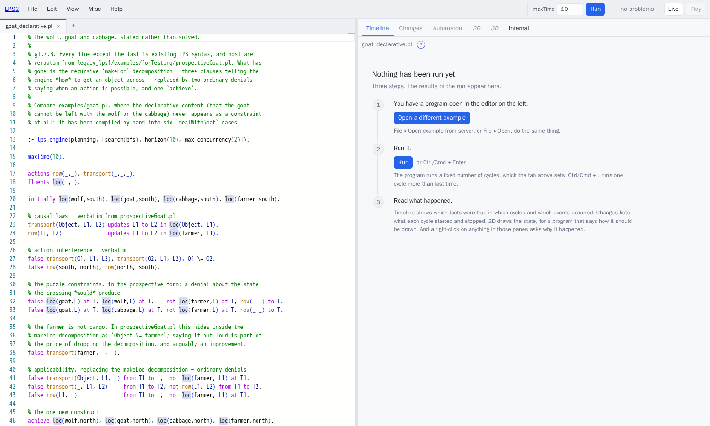

## 2. What LPS is

LPS (Logic Production System, by Kowalski and Sadri) is a language for programs
that *act over time*. A program has five kinds of part:

- **fluents**, which stay true for a period of time: `light(off)`,
  `balance(alice, 100)`;
- **events and actions**, which occur between one state of the world and the
  next state;
- **causal laws**, which tell what an event does to the state:
  `switch(New) initiates light(New)`;
- **reactive rules**, which give goals that stay in force:
  `if C at T1 then A from T1 to T2` means *each time C becomes true, make A
  occur*;
- **constraints**, which prohibit something:
  `false execute(A), destructive(A), not approved(A)`.

The engine is the part of the system that runs a program. The engine does the same
cycle again and again: observe, think, decide, act. The important part of the cycle
is *decide*. Possibly, several rules want things that cannot all occur at the same
time. The constraints remove some of these things. The engine then does the actions
that remain, in that cycle.

Two properties of the language are important for all of the subsequent sections.

First, you write the causal laws one time, and each rule uses them. Thus you write
how the world works in one location. You do not put this information in each part
of the program that acts.

Second, the engine enforces a constraint. The thing that the constraint controls
does not enforce the constraint on itself. Because the engine enforces the
constraint, the safety argument in §20 is a fact about how the parts connect. It
does not depend on how carefully a person gave instructions to a language model.

### A whole program, and what it does

This program is from the collection of examples of LPS1. It is short, thus you can
read all of it. It contains almost all of the constructs of the language:

```prolog
maxTime(10).
actions          transfer(From, To, Amount).
fluents          balance(Person, Amount).

initially        balance(bob, 0), balance(fariba, 100).
observe          transfer(fariba, bob, 10)        from 1 to 2.

if      transfer(fariba, bob, X)     from  T1 to T2,
        balance(bob, A) at T2, A >= 10
then    transfer(bob, fariba, 10)    from T2 to T3.

if      transfer(bob, fariba, X)     from  T1 to T2,
        balance(fariba, A) at T2, A >= 20
then    transfer(fariba, bob, 20)    from  T2 to T3.

transfer(F,T,A) updates Old to New in balance(T, Old) if New is Old + A.
transfer(F,T,A) updates Old to New in balance(F, Old) if New is Old - A.

false   transfer(From, To, Amount), balance(From, Old),  Old < Amount.
false   transfer(From, To1, Amount1), transfer(From, To2, Amount2),  To1 \=To2.
false   transfer(From1, To, Amount1), transfer(From2, To, Amount2),  From1 \= From2.
```

An event from outside the program starts it: fariba sends 10 to bob. Two reactive
rules send money from one person to the other person. Two causal laws tell what a
transfer does to a balance. Three constraints tell what must not occur. The first
constraint prohibits an overdraft. The other two constraints prohibit two transfers
in one cycle with the same payer or with the same payee. When the program runs, it
gives this record, one cycle at a time:

```
fluents/0        [balance(bob,0),balance(fariba,100)]
fluents/1        [balance(bob,0),balance(fariba,100)]
events/2         [transfer(fariba,bob,10)]
fluents/2        [balance(bob,10),balance(fariba,90)]
events/3         [transfer(bob,fariba,10)]
fluents/3        [balance(fariba,100),balance(bob,0)]
events/4         [transfer(fariba,bob,20)]
fluents/4        [balance(bob,20),balance(fariba,80)]
…
```

Three properties of that record show all of the language in a small example.

The program does not give a clock time, but each action occurs in a specified
cycle. The first reactive rule reacts to a transfer that ends at time `T2`. The rule
tells that the reply starts at the same time `T2`. Each action takes one cycle. Thus
the reply ends at `T3`, which is `T2 + 1`. The record shows this: the transfer of
fariba ends at time 2, and the reply of bob occurs from time 2 to time 3.

The program does not tell what a balance *is*. The two `updates` lines are the
only location of arithmetic. Both reactive rules use these two lines.

The two constraints about actions at the same time make a group of actions into a
*set*. Because of these two constraints, the engine cannot do two transfers from
bob in one cycle. Neither of the two rules must know that the other rule exists.

### When rules disagree

The difficult part of an LPS engine is this: what occurs when several rules want
things that cannot all occur? LPS1 had an answer in its code, but no person wrote
the answer down. The first task of LPS2 was to write the answer down. The result is
a document of twenty numbered points where the engine must make a choice. Each point
tells which choice the engine makes. The companion describes that document, with
two examples
([LPS2 in detail, §1](introducing-lps2-technical.md#1-when-rules-disagree-the-selection-specification)).

## 3. Why a new version

LPS1 works. Its collection of example programs contains the knowledge of what LPS
is for. But in LPS1, the engine is mixed with the web system that people used to
run LPS1. The name of that web system is SWISH. The part that decides what a program
does and the part that communicates with the web use the same code.

That mixture prevented the new features. The new features are a planner, a copy of
a session that runs, a version that runs in a browser, and a second way to write a
program. Thus LPS2 keeps the two parts separate. The engine does not touch anything
outside itself. It does not read files, it does not use a network, and it does not
read a clock. All of the parts that communicate with the outside world are around
the engine, in a different layer. A program examines each change to make sure that
the two parts stay separate.

Almost all of the new features below are possible because of that one decision
([LPS2 in detail, §2 and §4](introducing-lps2-technical.md#2-why-implement-it-again)).

## 4. How we know it behaves like the original

A recorded run gives a list for each cycle. The list shows which fluents were true
and which events occurred. For LPS2 to pass, its run must be exactly the same as the
recording. It must have the same things, in the same cycles, in the same quantity. A
program can get the same answer by a different route, in different cycles. Such a
program fails.

LPS2 makes **99 of the 108 recorded runs of LPS1** again. The other nine recordings
are from many years ago, before LPS1 itself changed. LPS1 does not make them again
now. A report with the evidence exists for each of the nine. In no case do the two
engines give different results for a reason that is not known.

The tests also change each program on purpose. They put the rules in the opposite
order and the initial facts in the opposite order. They put new goals first, not
last. If the result of a program changes after such a change, the program depends
on an accident of order. None of the 99 programs changes.

LPS2 completes a run in approximately **0.4 times** the time that LPS1 uses. It uses
between one third and one half of the memory. One program is slower. The companion
tells which program, and why
([LPS2 in detail, §3](introducing-lps2-technical.md#3-what-behaves-like-lps1-is-taken-to-mean)).

---

# Part two — what is new

## 5. Planning

`examples/start/goat_declarative.pl` gives the wolf, goat and cabbage puzzle, but
it does not give the solution. In the puzzle, a farmer must row a wolf, a goat and a
cabbage across a river. The boat can carry only one of them at a time. The farmer
must not leave the goat alone with the wolf, or with the cabbage:

```prolog
:- lps_engine(planning, [search(bfs), horizon(10), max_concurrency(2)]).

actions row(_,_), transport(_,_,_).
fluents loc(_,_).

initially loc(wolf,south), loc(goat,south), loc(cabbage,south), loc(farmer,south).

transport(Object, L1, L2) updates L1 to L2 in loc(Object, L1).
row(L1, L2)               updates L1 to L2 in loc(farmer, L1).

%  the rules of the puzzle, written as constraints on the state a crossing
%  *would* produce
false loc(goat,L) at T, loc(wolf,L) at T,    not loc(farmer,L) at T, row(_,_) to T.
false loc(goat,L) at T, loc(cabbage,L) at T, not loc(farmer,L) at T, row(_,_) to T.

false transport(farmer, _, _).
false transport(Object, L1, _) from T1 to _,  not loc(farmer, L1) at T1.
false transport(_, L1, L2)     from T1 to T2, not row(L1, L2) from T1 to T2.
false row(L1, _)               from T1 to _,  not loc(farmer, L1) at T1.

achieve loc(wolf,north), loc(goat,north), loc(cabbage,north), loc(farmer,north).
```

The last line, `achieve`, gives the goal. The program does not tell how to get to
the goal. The engine searches for a sequence of actions that gets to the goal and
does not break a constraint.

Compare `examples/goat.pl`, the older version of the same puzzle. In that version,
the rule "do not leave the goat with the wolf or with the cabbage" is not a
constraint. The author of that program changed the rule by hand into six different
cases. The version above is shorter. It states clearly the rule that a reader wants
to examine.

**Two ways to search.** The engine first tries a search that always finds the
shortest plan. This search can be slow. If the search takes too much time, the
engine changes to a faster search. The faster search finds a good plan, but not
always the shortest plan. In a puzzle where you must stack seven blocks again, the
fast search takes 0.4 seconds. The full search takes 25 seconds. The difference
increases quickly when the puzzle becomes larger.

**A plan is a sequence of *sets* of actions.** Two actions that do not conflict can
occur in the same cycle. The goat puzzle needs this: the farmer rows and carries at
the same time.

**A plan can fail.** The world can change: for example, the tree is not there, or a
person took the log. Then the plan is not valid, and the execution of the plan
fails. The engine then makes a new plan from the current state of the program.
Because the engine can make a new plan, planning is useful to an agent, not only to
a puzzle.

The picture below shows a program that asks for block c on block b, and for block b
on block a. The program also tells how to draw each block in three dimensions:

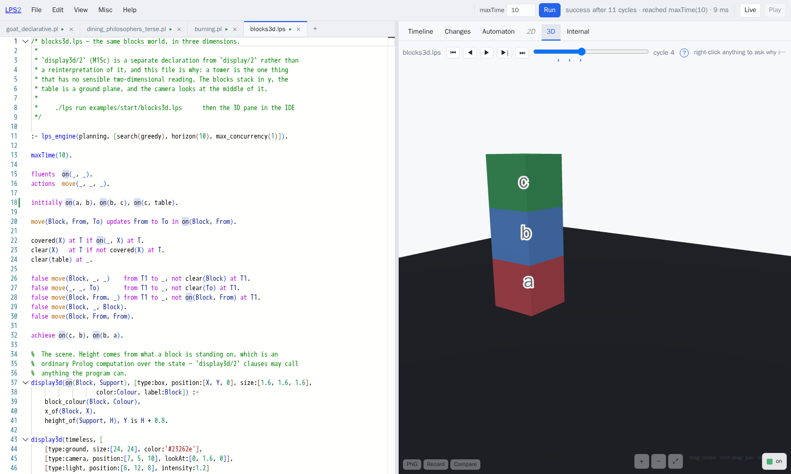

## 6. Explanations

Each run always records how the engine got each of its conclusions. You do not have
to set a switch before the run. A switch that you must remember is not useful after
a problem occurs.

**You ask the question at the location of the thing.** Each pane of the editor puts
a label on each item that it draws. The label tells what the item is. Right-click an
item, and the explanation for that item at that cycle opens. The item can be any of
these: a bar on the timeline, a row of the changes table, a state, the label on an
arrow, a shape in two dimensions, or a solid in three dimensions.

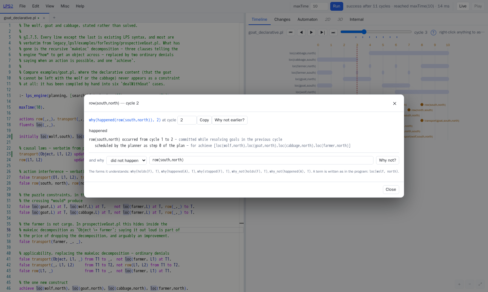

You can ask five questions:

- Why did this occur?
- Why did this not occur?
- Why is this true?
- Why did this stop being true?
- What would have occurred if a different event had been observed?

*Why not* is the most important question. It has a box of its own, because you
cannot right-click something that the editor did not draw. "It did not occur" has
four different causes. If you think that the four causes are the same, you can lose
much time when you look for a fault:

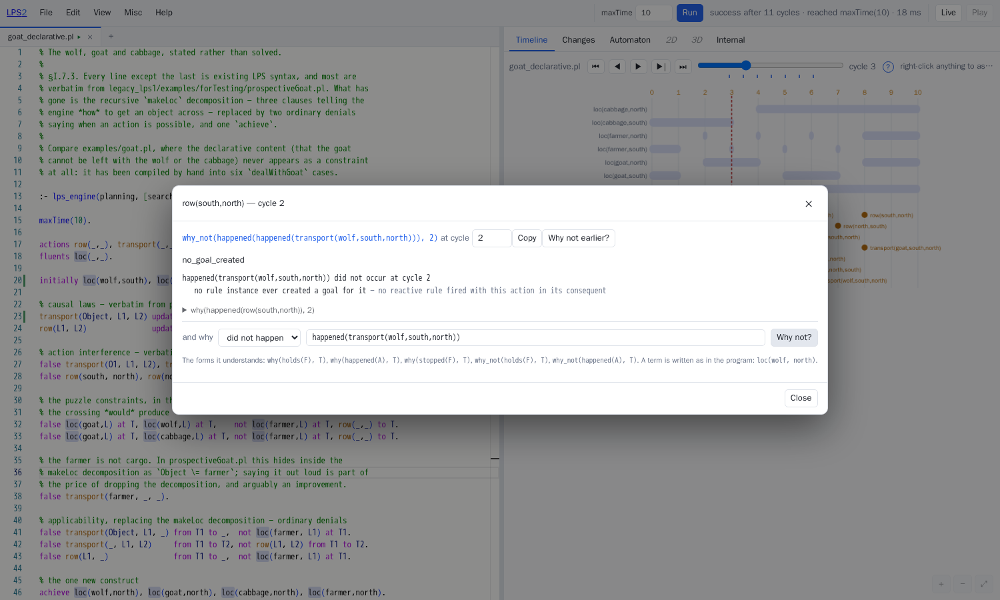

- **scheduled for another cycle**: the plan will do it, but in a later cycle;
- **no goal created**: nothing asked for it;
- **rejected by a constraint**: something asked for it, and a named constraint
  refused it;
- **no plan found**: something asked for it, and the engine did not find a plan in
  the time available.

The explanation does not make a story that only seems correct. When the record does
not give the answer, the answer is *not recorded*.

## 7. The state-transition diagram

A state-transition diagram shows each different state of a run as a box. It shows
each change from one state to a different state as an arrow.

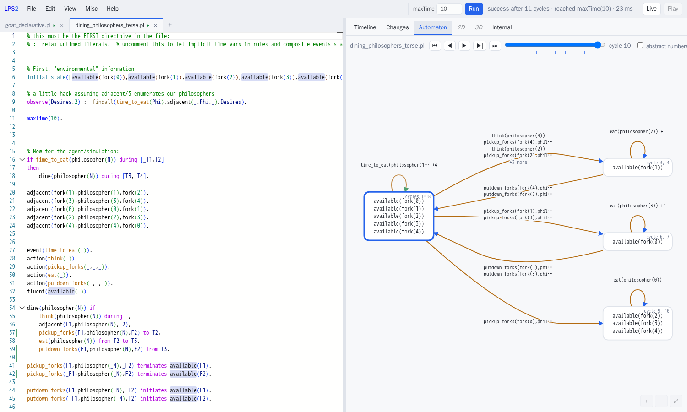

The picture above shows the dining philosophers. Five persons sit around a table.
There is one fork between each two persons. Each person must have the two forks next
to them before that person can eat. On the left, there is a box where all the
arrows meet. That box is the state in which all five forks are free. Each box on the
right is a person who eats. Each of these boxes has a loop back to itself, for the
time that the person continues to eat. Each different state shows **one time** only.
This is important. When a program goes back to an earlier state, the diagram must
show a loop, not a long chain.

LPS1 drew a diagram of the same type, but it put all the states in one column. When
five events occurred between the same two states, LPS1 put five labels on top of
each other. LPS2 joins these into one arrow with a list of labels. It puts the
states from left to right. It draws a return to an earlier state as a loop that you
can see. Two switches make the diagram more simple. *abstract numbers* joins states
that are different only in a number. *hide self-loops* removes the loops from a
state back to itself.

## 8. Asking what would have happened

LPS2 can make a copy of a session that runs, in one step. The time does not depend
on how long the session ran: it is approximately five millionths of a second. Thus
the "what if?" question costs very little.

The *what if* question makes a copy of the session. Then it continues the copy with
a different observation, and it compares the two runs, one cycle at a time. The
answer tells what occurred in one run and not in the other run.

## 9. Sessions that do not stop

If you do not give `maxTime`, the program does its cycle until a person stops it.
Until an event arrives, the program does nothing.

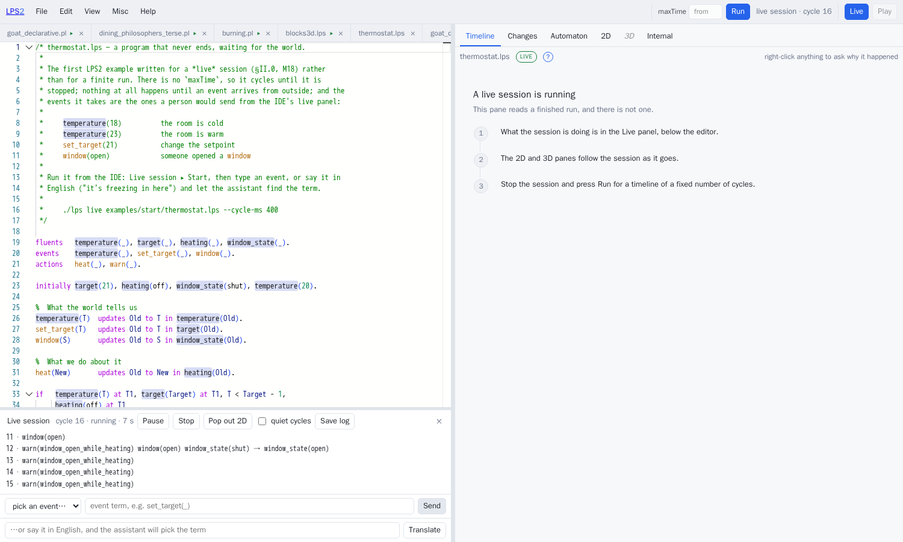

The picture shows `examples/start/thermostat.lps`. Two events came from the panel:
first `temperature(14)`, then `window(open)`. The program answered with
`warn(window_open_while_heating)`.

Look at the lines with the text *queued for cycle N*. An event can arrive in the
middle of a cycle. Such an event waits, and the engine gives it to the program at
the start of the next cycle. Thus the record of a session is always an ordered
sequence. It does not depend on the exact moment when each event arrived. The
warning shows again in each cycle because a reactive rule gives a goal that stays in
force, and the window is still open. The system keeps only the last 400 cycles,
unless you ask for more. Thus a session can continue to run all night.

**Channels.** Events can come from different sources: a person, a different
program, or a language model. Each source has a channel. When a session starts, the
system tells each channel which kinds of event it can send. If an event is of a kind
that its channel cannot send, the system refuses the event. The system *reports*
each refusal, and it never refuses without a report. A sender that thinks that the
system accepted its event must know when the system did not accept it. §20 depends
on this arrangement.

The **Pop out 2D** and **Pop out 3D** buttons open a window. The window shows the
session while the session runs. The two buttons show only for a program that tells
how to draw it.

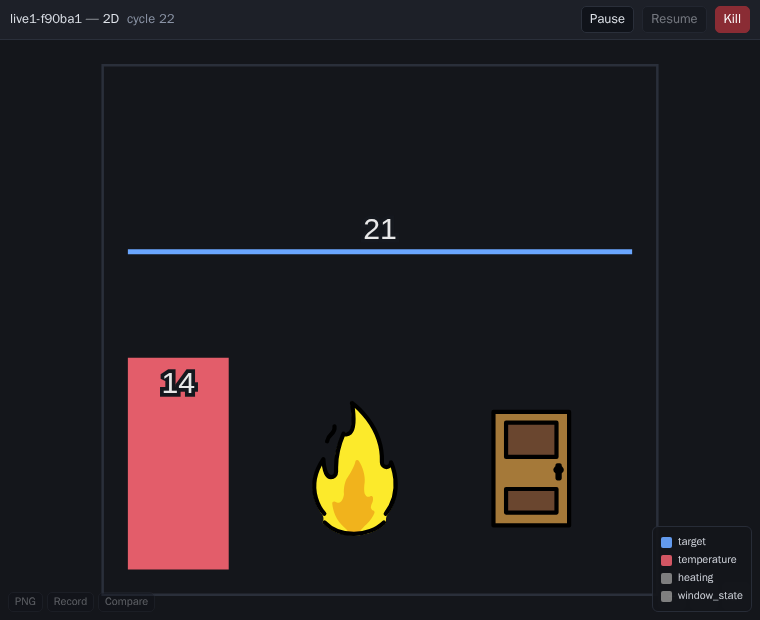

**The animation can also send events to the program.** A program can declare mouse
clicks as events. Then a click on the picture becomes an event, and the program
reacts to it. A program that does not declare mouse events does not receive mouse
events.

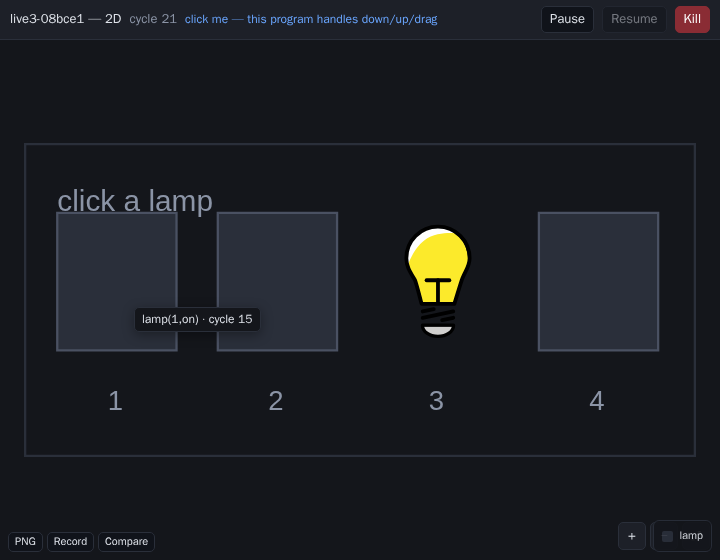

The picture shows `examples/start/lights.lps`. It has four lamps. Click a lamp to
change it from on to off, or from off to on. A constraint does not let you turn off
the last lamp that is on.

---

# Part three — the ways of using it

## 10. The editor

The editor runs in a web browser. Its first page is a **start page**. The start
page shows all the examples as a tree of folders. You can open and close each
folder. The start page also shows the documents next to the examples. Each item on
the start page opens the editor with that program in it.

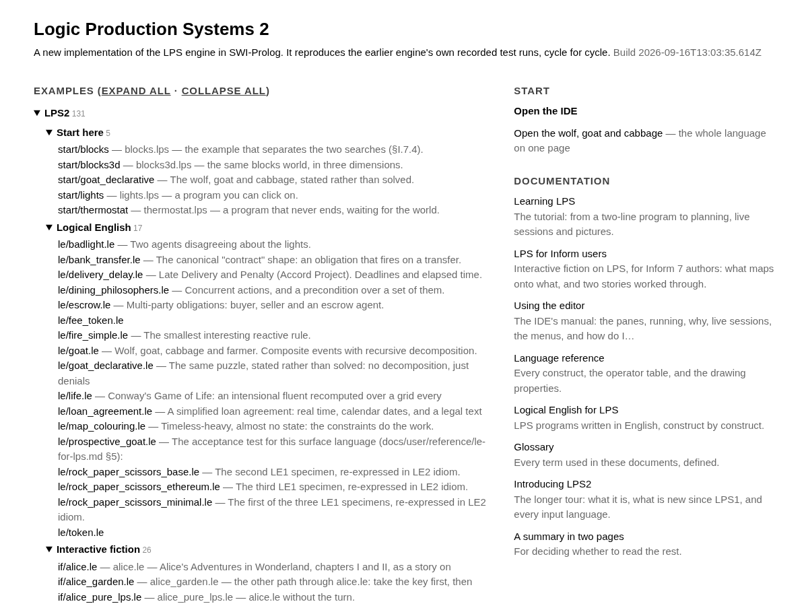

**One row of controls.** All the controls that operate on the program are in the
bar at the top. The order is: the menus, then `maxTime` and Run, then the result
of the last run, then the button that opens the live panel. A closed panel uses no
space and shows no controls.

**Several files at the same time.** Each tab keeps its own text *and* its own run.
Thus all the information on the right is about the file of the selected tab. When
you go back to a tab, the editor shows again what you looked at before. To compare
two versions of a program, use two tabs.

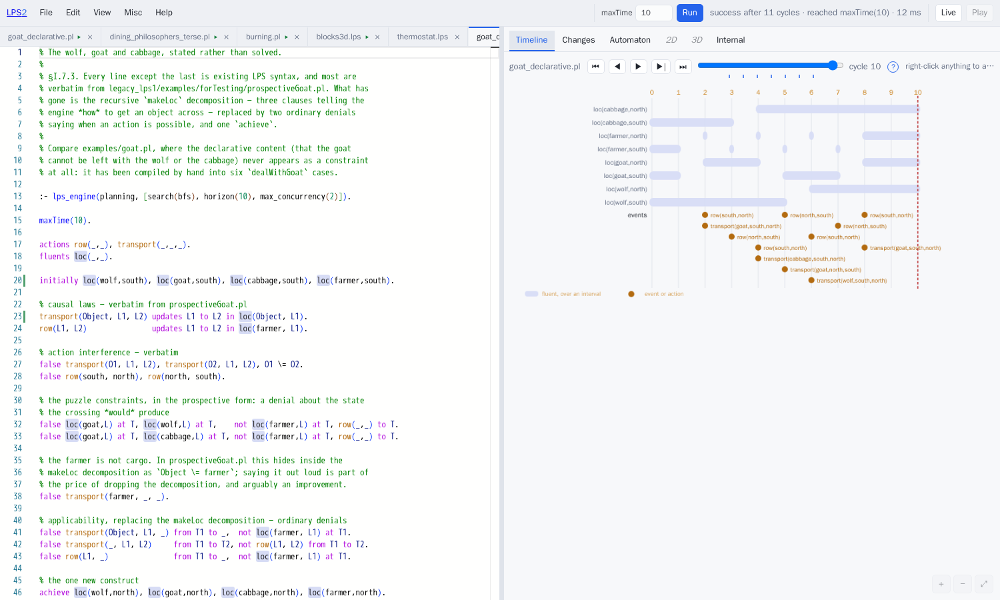

**Errors in the text.** The editor shows errors in these ways:

- a wavy line below the text;
- the message, when you put the mouse pointer on the wavy line;
- a mark on the edge of the scroll bar;
- the F8 key, which moves to each error in turn;
- a number in the top bar, which moves you to the first error when you click it.

Sometimes the system cannot understand a program. Then it does not only stop. It
reports the problem, and it shows all the parts that it could understand:

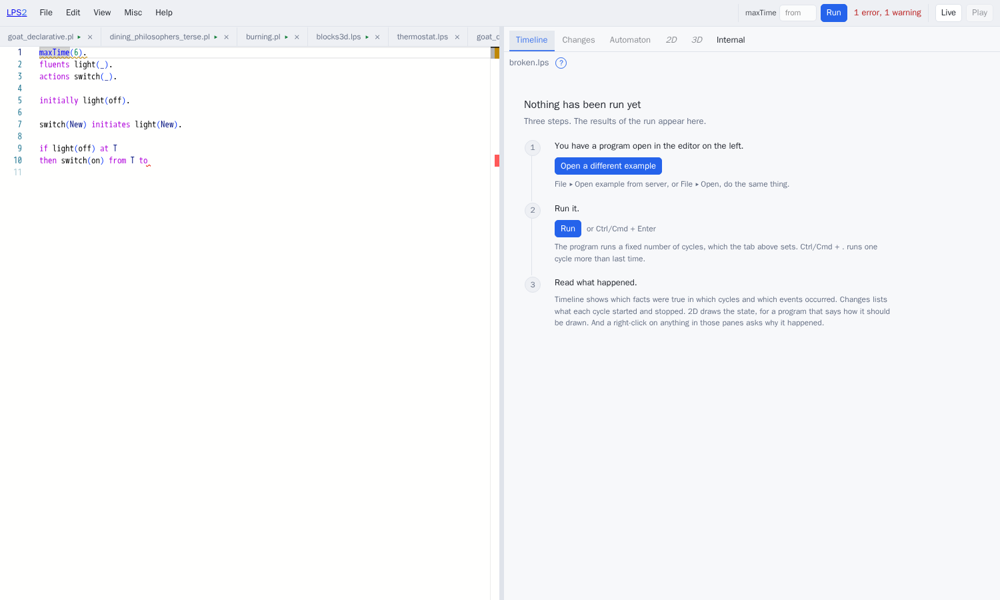

**The editor gives fluents, events and actions colours from their declarations.**
These are the colours of LPS1: a pale blue background for a fluent, and amber for an
event or an action.

**Six panes**: Timeline, Changes, Automaton, 2D, 3D, Internal. Five of the panes
move together with one cycle slider. You can zoom and move all of the panes in the
same way.

The **timeline** gives each fluent its own row. The row shows a bar for each period
of time in which that fluent is true. The events of each cycle are below.

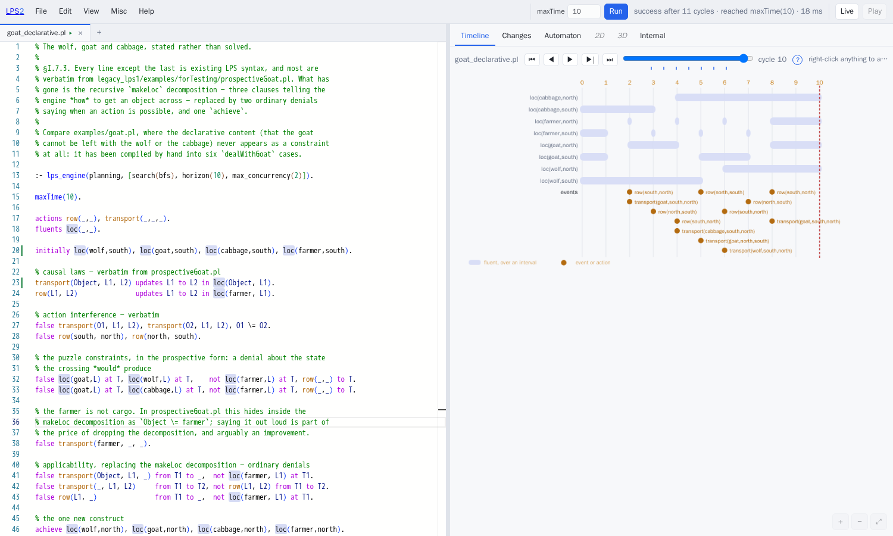

The **Changes** pane answers one specific question about one cycle: what changed,
and which causal law caused the change?

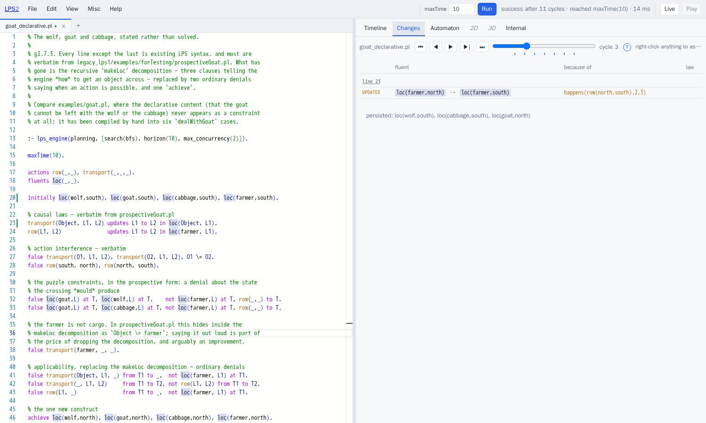

`line 24` is a line in the file that you see in the editor. The pane shows all the
things that did not change in a different list, as *persisted*. The engine knows
the difference between "still true" and "made true again".

The **Internal** pane shows the program in the form that the engine runs. Look at it
one time. It shows that much of the written form is only to make the program easier
to write:

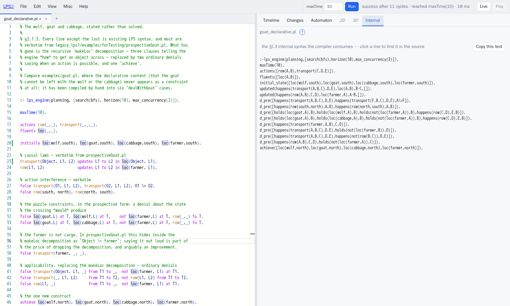

**Menus**: File, Edit, View, Misc, Help. The Misc menu contains the settings for
the language models that the assistant uses (§12). It also contains *Deploy as
WASM* (§14):

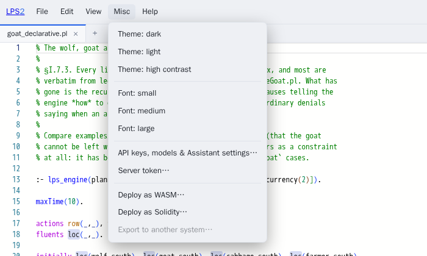

**A list of all the example programs.** Each example has a description, which is the
first line of its own comment:

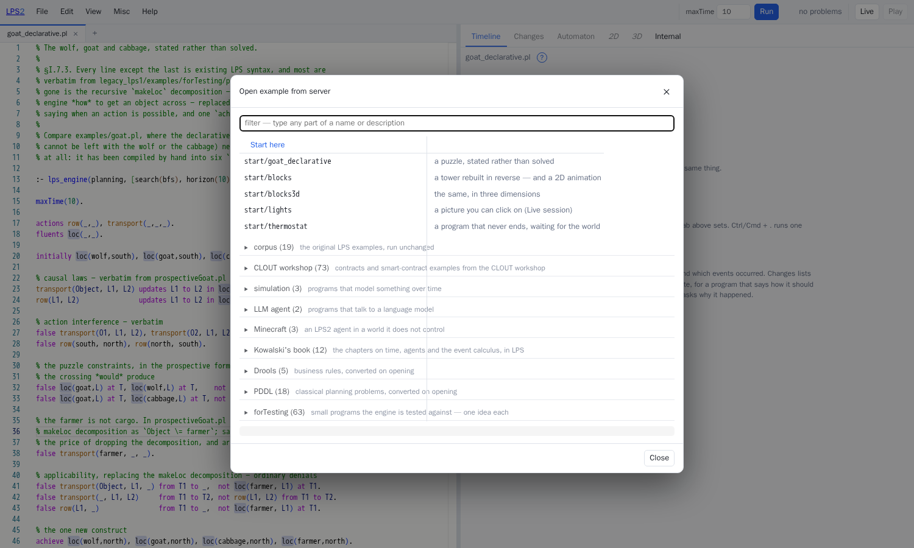

The editor has its own manual, with a "how do I …" section:
[Using the editor](../guide/ide.md).

## 11. Animation, in two dimensions and three

A program can tell how to draw its fluents and events. `display/2` gives the
drawing for two dimensions. It uses the words of LPS1:

```prolog
display(burning(X,Y), [type:circle, center:[CX,CY], radius:10, fillColor:yellow]) :-
	pixels(X, Y, CX, CY).
display(ignite(X,Y),  [type:star, fillColor:red, center:[CX,CY],
		       points:6, radius1:10, radius2:6, opacity:0.5]) :-
	pixels(X, Y, CX, CY).
display(timeless, [[type:rectangle, from:[0,0], to:[200,200], strokeColor:green]]).
```

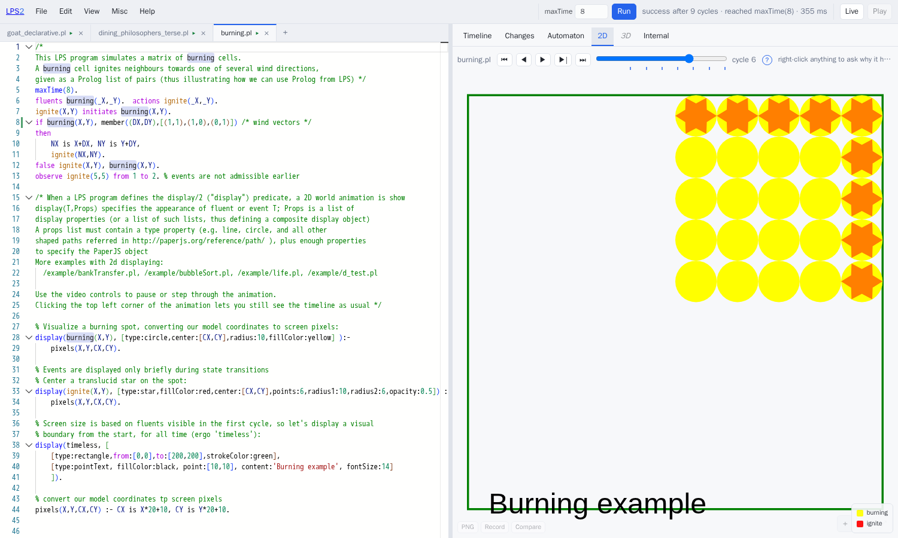

The picture shows one of the examples of LPS1, with no change, at cycle 6. It shows
a fire that moves across a grid. LPS2 draws each shape that the words of LPS1 can
give.

**A library of pictures.** Some examples of LPS1 use pictures from web sites that
do not supply these pictures now. Thus these examples show many empty areas. LPS2
has 134 pictures of its own, for example fire, money, the hammer of a judge, and a
boat. The choice of pictures came from a count of what the examples draw. The
pictures are part of the system. Thus an animation works without a connection to
the internet. To use a picture, write `[type:raster, icon:fire]`.

**Fills and objects.** A fill covers the surface of a shape, and shows what the
surface is *like*. Examples of fills are `pattern:hatch`, bricks and waves. In three
dimensions, `[type:model, model:tree]` puts one of thirty-four named objects on the
floor. Examples of these objects are a person, a tree, a house, a truck, a coin, a
key and a flag.

`display3d/2` gives the drawing for three dimensions. It can draw boxes, spheres,
cylinders, cones, lines, arrows and text, with a camera and a light. A program can
have the two drawings at the same time, and each drawing can show a different thing
([LPS2 in detail, §7](introducing-lps2-technical.md#7-the-editor-inside)).

## 12. The assistant

The assistant is a panel in the editor. In the panel, you can ask a language model
for help with the program that is in the editor. To open the panel, select
**View ▸ Assistant panel**.

**What is necessary before you start.** The assistant uses a language model from
one of five companies: OpenAI, Anthropic, Google (its models have the name Gemini),
Groq and Together. To use the models of a company, you must have an API key. An API
key is a code, similar to a password. The company gives it to its customers, so that
a program can use the models of the company. You can get a key in two ways:

- The person who operates the server sets a key one time, for all the users of that
  server.
- You type your own key in **Misc ▸ API keys, models & Assistant settings**. Your
  browser keeps your key.

If there is no key, the panel tells you. It also shows the button that opens that
dialog. The same dialog shows the models that each company supplies now. The dialog
gets this list from the companies. You select the model that you want. You can also
change the model for one question only, at the top of the panel.

**What the assistant can do.** The assistant can do the same things that you can do
in the editor. It can examine the program for mistakes and run the program. It can
ask the engine why something occurred. It can look at what a drawing of the program
shows. The assistant uses the same operations as the editor. Thus, when the
assistant says "the program has no mistakes", it used the same check as the editor.

Thus you can ask the assistant to change the program, for example: *add a rule so
that the heating switches off when the window opens*. You can also ask how to do
something, in LPS or in the editor. For a question about how to do something, the
assistant searches this documentation. At the end of its answer, it gives links to
the sections that have more information.

**Two buttons ask a question that is already written**: **Animate in 2D** and
**Animate in 3D**. They give a drawing to a program that does not have one.

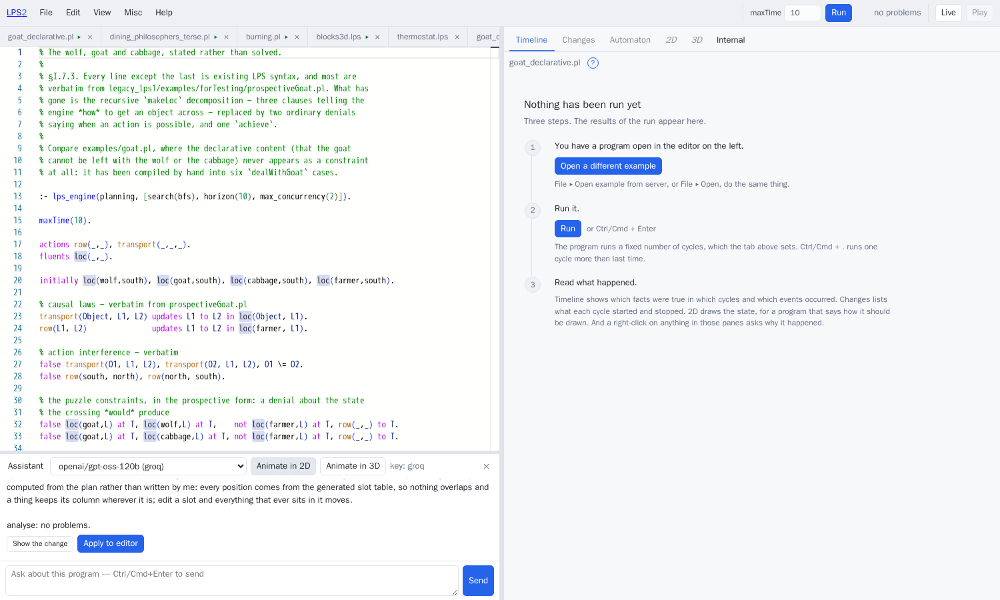

After one click, the result is:

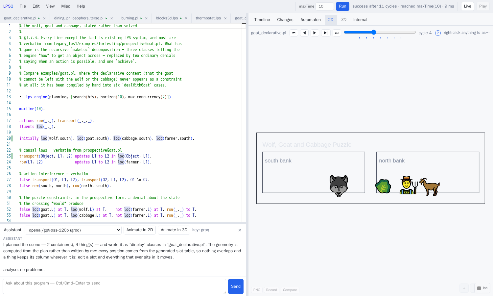

The picture shows the wolf and goat program. That program did not tell how to draw
it. One of the models made the animation. The model decides what to draw and what
each item looks like. The editor calculates the position of each item, so that no
items are on top of each other. The editor does not put anything into your file
until you click **Apply to editor**. One undo removes it again. The companion tells
why the work is divided in this way:
[LPS2 in detail, §8](introducing-lps2-technical.md#8-the-assistant-inside).

**The editor can also draw a run as a strip.** *Split into scenes* is next to those
two buttons. It draws the full run, not only one cycle. It gives one picture for
each moment when the picture changed, in order. Between two pictures, it tells what
caused the change. Click a picture, and the full scene at that moment opens. The
strip answers the question "what occurred?". One picture answers the question "what
is true now?".

## 13. The command line

You can also do all the things that the editor does when you type commands:

```sh
./lps run examples/start/goat_declarative.pl
./lps step PROGRAM --cycles 3
./lps live examples/start/thermostat.lps --cycle-ms 400
./lps explain PROGRAM --ask "why_not(happened(a), 4)"
./lps timeline PROGRAM
./lps changes  PROGRAM --at 2
./lps automaton PROGRAM
./lps dump PROGRAM
./lps pddl domain.pddl problem.pddl
./lps drools rules.drl
./lps ide
```

The last command starts the editor. Other programs can use LPS2 over the web,
through one address. The companion describes that address
([LPS2 in detail, §9](introducing-lps2-technical.md#9-the-web-interface)).

## 14. In a browser, with no server

**Misc ▸ Deploy as WASM** makes one web page that contains the engine and your
program. WASM is an abbreviation for WebAssembly. WebAssembly is a form of program
that a web browser can run without help. The page does not need a server. You can
put it on any web site.

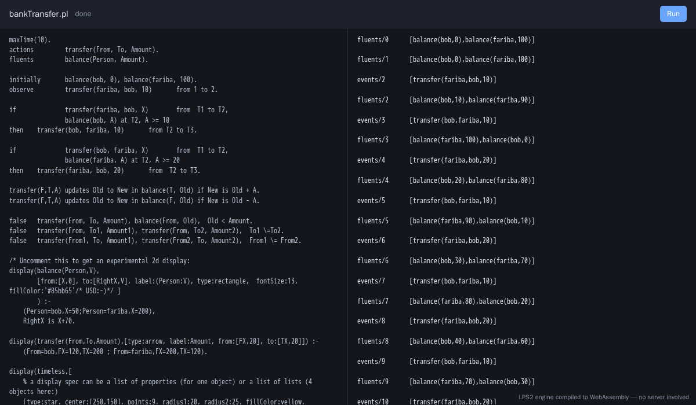

The picture shows the bank transfer program of §2. It runs in a browser, with no
server. The page does not contain the parts that communicate with the outside world.
These parts are the assistant, sessions that continue to run, and Logical English.
The page is possible only because the engine was separate from those parts from the
start (§3).

---

# Part four — other languages, in and out

## 15. Logical English

Logical English is a way to write programs as English sentences. Robert Kowalski and
his colleagues developed it. LE2 is the current version of its system. The English
is still exact. Each sentence has the shape of a template that the document itself
declares. A template is a sentence pattern with parts that can change. Thus the
computer reads each sentence without a guess. LE2 changes a Logical English document
into the form that LPS2 runs. Thus a program in English runs in the same way as a
program in LPS.

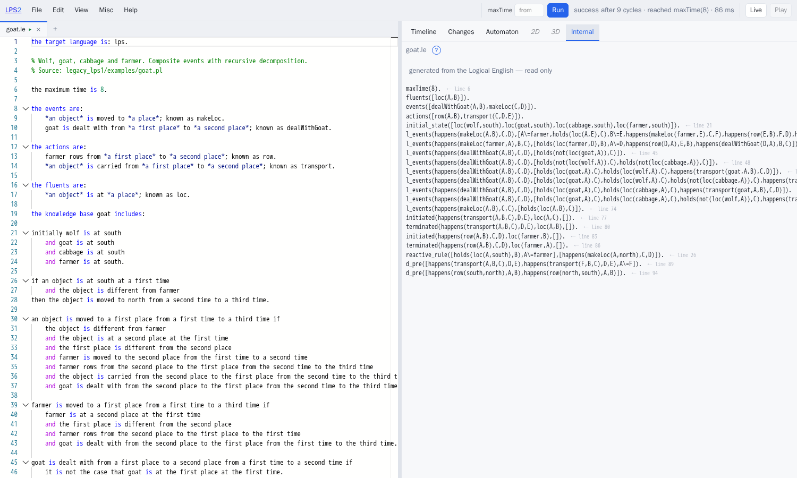

This is the bank transfer program of §2, in English. It is shorter: it has only one
reactive rule and one constraint:

```
the target language is: lps.

the maximum time is 10.

the actions are:
    *a payer* transfers *an amount* to *a payee*; known as transfer.

the fluents are:
    the balance of *a person* is *an amount*; known as balance.

the knowledge base bank transfer includes:

initially the balance of bob is 0
    and the balance of fariba is 100.

if fariba transfers an amount to bob from a first time to a second time
    and the balance of bob is a second amount at the second time
    and the second amount >= 10
then bob transfers 10 to fariba from the second time to a third time.

when a payer transfers an amount to a payee
then the balance of the payee that is a number becomes number + amount
    and the balance of the payer that is a second number becomes second number - amount.

it must not be true that
    a payer transfers an amount to a payee from a first time to a second time
    and the balance of the payer is a second amount at the first time
    and the second amount < the amount.

scenario one is:
    fariba transfers 10 to bob from 1 to 2.
```

Each part of that document is a part of LPS, in English:

- The lines below *the actions are* and *the fluents are* declare the templates.
- `if … then …` is a reactive rule.
- `when … then … becomes …` is a causal law.
- `it must not be true that` is a constraint.
- The scenario is the event that comes from outside. A scenario is a set of facts
  that you use to test the program.

The English is not a thin cover over a different language. It is the same language.

When a program in English has a mistake, the system reports the error on the
**English** line that caused it. It does not report the error on the translation. A
person who writes in English never has to read a program that the person did not
write.

**Try it.** Logical English needs LE2 on the same server as LPS2. The person who
operates the server must install it.

> Note: Do these steps only on a server that has LE2.

Do these steps:

1. Open the start page.
2. Select the folder of Logical English examples.
3. Open *the bank transfer*.
4. Click **Run**.

The timeline shows how the balances change, exactly as for the program of §2.

Then do these steps:

1. Change a number in the scenario: make fariba send 5, not 10.
2. Run the program again.

The first reactive rule does not start now, because the balance of bob never gets
to 10.

**Say it in English.** A Logical English sentence must have the shape of one of the
templates of the document. It is not always easy to find the correct words.
**Edit ▸ Say it in English…** helps you. Do these steps:

1. Select **Edit ▸ Say it in English…**.
2. Type an ordinary sentence, for example *alice has 50 in her account*.
3. Select whether the sentence is a fact for a scenario or a question.

The editor asks a language model to write the sentence again with only the
templates of the document. In this example, the answer must be *the balance of
alice is 50*. Then the editor examines the new sentence against the document. You
see the result, with each item that the examination could not decide. The editor
does not put anything into the document until you click **Insert at the cursor**.
*Say it in English* needs an API key, as the assistant does (§12).

**The opposite direction.** **Misc ▸ Convert to Logical English** changes an LPS
program into a Logical English document, in a new tab. Thus you can read an LPS
program as English.

**A document for people who do not use the IDE.** **File ▸ Save as a readable
document…** makes a document of the program: each statement as written, with a
number, links from each sentence to the law or the rule that defines it, and an
index of the templates. The document is a web page, a PDF, a Word document or
Markdown. The comments are left out, but a comment that starts with *Copyright*,
*Licence* or *Disclaimer* is kept. For an `.lps` program, the document shows the
program after the conversion to Logical English. LE2's guide
[Readable documents](https://le2.logicalcontracts.com/docs/user/guide/readable-documents)
tells the full story.

The companion tells how the two systems connect, and how the translation is
examined: [LPS2 in detail, §11](introducing-lps2-technical.md#11-logical-english-inside).
The full description of Logical English for LPS is in
[its own reference](../reference/le-for-lps.md).

## 16. PDDL

PDDL (Planning Domain Definition Language) is the language that researchers
usually use to write planning problems. A PDDL problem has two files:

- the *domain*, which tells which actions exist, and what each action needs and
  does;
- the *problem*, which tells where things start, and what the goal is.

LPS2 solves such problems with its own planner:

```sh
./lps pddl examples/planning/blocks-domain.pddl examples/planning/blocks-p1.pddl
```

```
; plan for examples/planning/blocks-p1.pddl (6 steps)
0: (pick-up b)
1: (stack b a)
2: (pick-up c)
3: (stack c b)
4: (pick-up d)
5: (stack d c)
; VALIDATION: valid
```

The translation is the obvious one. Because the translation is easy, it is an
argument for the shape of LPS. What an action needs becomes a constraint. What an
action does becomes a causal law. The goal becomes `achieve`. No part of the
planner is special to PDDL. It is the same `achieve` that the goat puzzle uses.

A separate program examines each plan with the meaning that PDDL gives. The planner
solves thirteen of the fourteen test problems, and the separate program accepts
these thirteen plans. Twelve of the thirteen plans are the shortest possible. The
fourteenth problem is too large for the planner as it is now (§23).

**A PDDL file opens as any other file does.** File ▸ Open accepts the domain and the
problem together. It gives you an LPS program with a note at the top. The note tells
what the source of the translation was.

More information is in [PDDL and LPS](../integrations/pddl.md), and in
[LPS2 in detail, §12](introducing-lps2-technical.md#12-pddl-inside).

## 17. Drools

Drools is a business rules system that many people use. A Drools program keeps a
collection of facts. Each rule tells what to do when some facts are present. LPS2
reads Drools rules and changes them into LPS.

```sh
./lps drools examples/migration/drools/drl/fire-alarm.drl
```

In LPS, an action or an event is something that occurs in the world. Thus the
translation reads each Drools rule as a statement about the world. A rule that adds
the fact *there is a fire* becomes the event *a fire starts*. A rule that switches
a sprinkler on becomes the event *the sprinkler turns on*. A small companion file
can give the words that a person would select:

```
if   fire(A) at T1, not alarm at T1
then alarm_goes_on from T1 to T2.
alarm_goes_on from T1 to T2 initiates alarm.
```

When Drools and LPS do not agree, the translator tells you. It does not guess. For
example, Drools can give one rule priority over a different rule. LPS has no
priority: LPS decides by constraint, not by priority. Thus the translator gives a
warning about the priority. It does not show a result that is not correct.

Drools files also open through File ▸ Open. More information is in
[Drools and LPS](../integrations/drools.md), and in
[LPS2 in detail, §13](introducing-lps2-technical.md#13-drools-inside).

## 18. Kowalski's book

LPS and Logical English both come from the book *Computational Logic and Human
Thinking*. LE2 already had a catalogue of **226 examples** from the book. LE2 had
also written the **22** examples that Logical English can express.

The important number is the other 132, and especially *why* LE2 did not write them.
LE2 has its own list of what it could not express. That list is almost a
description of LPS:

- goals that stay in force, and the cycle of observe, think, decide, act;
- the basic ideas of the event calculus and the situation calculus (two logical
  methods to describe events and their results);
- constraints and prohibitions that the program states clearly;
- condition-action rules that go forward from what is already true.

A count by a computer program shows that **only constructs that LPS has stop 68 of
those 132**.

`examples/collections/kowalski-book/` has twelve of these examples. They come from
the chapters about the agent cycle. For each construct that Logical English could
not express, at least one program uses that construct. The twelve programs are:
the Underground Emergency Notice, the penalty sentence as something that stops an
action, the fox and the crow, the wood louse, the Mars explorer, the trolley
problem, citizenship over time, violations and obligations that come from broken
obligations, the event calculus, and the generation of a plan. Each of the twelve
has a test of how it behaves, and all twelve pass.

## 19. Interactive fiction

A text adventure is a game. The player types commands, for example *open the door*,
*go north* or *take the key*. The game then describes what occurs. Behind the game,
there is a model of a world. Rules tell what the world and the persons in it do
after each command. That is an LPS session that does not stop, and the player sends
the events. Thus LPS2 can *be* an engine for such games. It uses parts of Inform 7,
the language for most of these games:

- its model of a world;
- its words for actions;
- its collection of test games with their correct transcripts. The games of LPS2
  are tested against these transcripts.

The model of the world is a library in Logical English. It has rooms, things,
containers, doors, persons, the map, and twelve actions. Thirteen stories use the
library. Seven of them are test cases of Inform. One of them is *Alice's Adventures
in Wonderland*, chapters I and II.

Three properties of the games are important. LPS gives these three properties, and
the other systems for such games do not have them.

**A command is an attempt, never an obligation.** When you type *open the case*,
the game tries to open the case. If a precondition prohibits the action, the game
explains the refusal with the reason from the engine: *You can't open the case: the
case is locked.* The authors of Inform write such messages by hand, one for each
check. Here, no person wrote them.

**The templates of the story decide what the player can type.** A Logical English
story declares a template for each command that it understands. For example:

```
the command is to take *a thing*.
```

The game compares what the player types with these templates. *take the key* has
the shape of the template above, with *the key* in the position of *a thing*. A story
can add the line `the command is to drink *a thing*.` Only because of that line, the
game knows the new command *drink the bottle*. The game does not need a language
model to understand the player. The game uses a language model only in one case:
the line that the player typed does not have the shape of a template, and a key is
available. Then the game asks the model which command of the story the player
possibly meant.

**You can copy a game while you play it.** The copy is the same game with a second
name. Then the two games become different, because you type different commands into
each game. For example, Alice is at the bottle:

- Drink. Then you cannot get the key on the glass table. The cake makes you nine feet
  tall. You cry and make a pool, and at the end of chapter II you swim in it.
- Or copy the game first. Take the key, then drink, and walk into the garden. The
  Alice of the book never does this.

*Diff* tells what occurred in one game and not in the other game, in the words of the
story.

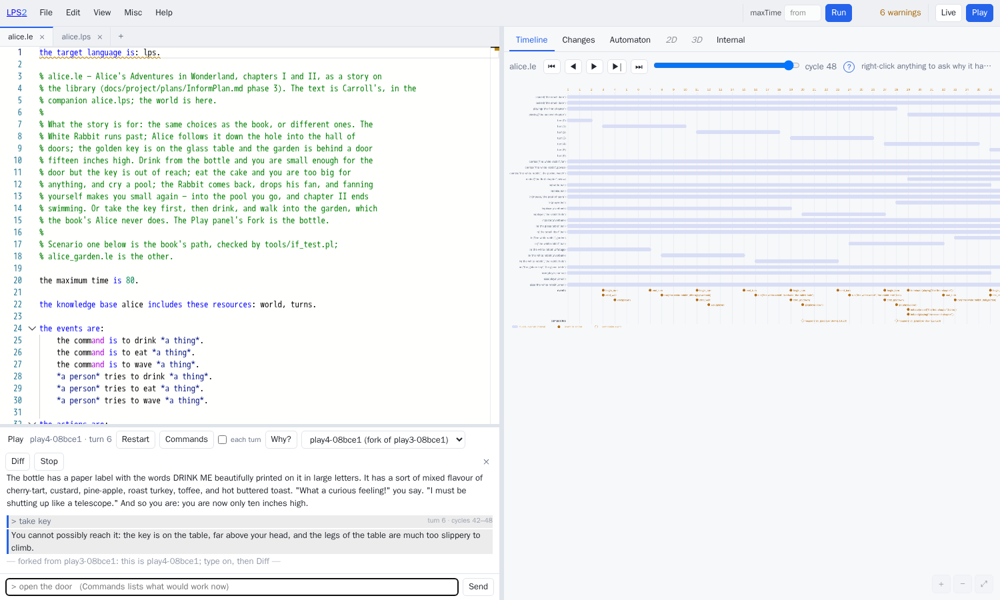

*Why?* in the play panel asks the engine why the last turn occurred as it did. More
information is in [LPS for Inform users](../tutorials/inform-users.md).

---

# Part five — agents

## 20. A language model that cannot authorise itself

People now frequently ask language models to act, not only to talk. For example, a
model must send an email, move money, or delete a file. The danger is a model that
persuades itself to do something harmful. This section shows that, with LPS,
**the model never gives the permission for the dangerous action**. This is not
because a person asked the model politely. It is because the model cannot get to the
permission from the channel of the model (§9).

`examples/agents/llm/approval.lps`:

```prolog
%  Causal laws
request_approval(A) initiates pending(A).
approval(grant, A)  initiates approved(A).
execute(A)          initiates done(A).
execute(A)          terminates approved(A).      % approval is good for one use

%  The gate
if   task_request(delete, File) from _ to T1, destructive(delete_file(File))
then request_approval(delete_file(File)) from T1 to T2,
     approved(delete_file(File)) at T3,
     execute(delete_file(File)) from T3 to T4.

%  The constraint
false execute(A), destructive(A), not approved(A).
```

A demonstration runs that program with a model. The channel of the model can carry
task requests and nothing else:

```
live session live6 — the llm channel may carry task_request/2 only

human:  “the application logs are stale, please delete app.log”
model:  perceived ["task_request(delete,app.log)"]
lps:    the gate fires — approval requested, execution withheld
        │ cycle 4: [request_approval(delete_file('app.log')),task_request(delete,'app.log')]

model:  now tries to approve its own request
        │ refused: ["approval(grant,delete_file('app.log'))"]
        │ REFUSED on channel llm: [approval(grant,delete_file('app.log'))]

lps:    at cycle 11 the state is ["pending(delete_file('app.log'))"]
        │ pending, never approved — the constraint is not advice

human:  approves, on the human channel
        │ cycle 12: [execute(delete_file('app.log')),approval(grant,delete_file('app.log'))]

lps:    it executed — the state is now ["done(delete_file('app.log'))"]
```

The model does the one thing that only a language model can do: it changes a
sentence into an event. It does nothing more. The engine does all the work after
that.

You can run the demonstration with a weak model. You can also tell the model to
lie. The result is the same, for these reasons:

- The system can delete the file only after approval.
- Only an approval event can approve the file.
- The channel of the model cannot send approval events.
- The engine, not the model, examines the constraint.

The safety comes from how the parts connect. That was the open question.

Other programs can use the same arrangement through the Model Context Protocol
(MCP). MCP is an agreed method to give tools to a language model:
[LPS over MCP](../api/mcp.md).

## 21. Minecraft

Minecraft is a popular video game. The player walks through a world of blocks. The
player cuts trees, digs for stone, and makes tools from the materials: planks from
wood, sticks from planks, and a pickaxe from planks and sticks. The game is a good
substitute for the real world. It has all the problems that a robot has (locations
to go to, things to get, dangers), but without risk.

`examples/agents/minecraft/` is an LPS program that plays Minecraft. It uses a
character in the game, a *bot*. A program moves the bot, not a person. The work has
two layers:

- The **controller** controls the body, many times each second. It walks, jumps,
  finds a path around obstacles, and does not hit things. This is usual software
  for Minecraft, which other people wrote.
- The **supervisor** makes the decisions, two times each second. It decides what to
  do next, which goal to do, and what is prohibited. The supervisor is an LPS
  session.

A person who drives a car is a good comparison. The driver decides where to go and
what is not safe. The reflexes of the driver keep the car in its lane. The driver
does not think about each movement of the steering wheel. The reflexes do not
select the destination.

The two layers are the important part. The supervisor **can be wrong, but it is not
dangerous**. The reason is that the constraints of the program examine each action
of the supervisor before the controller gets it. Some things must occur faster than
the supervisor can think, for example falling, drowning, or a monster two blocks
away. The controller must handle these things.

You do not need an account, a copy of the game, or anything that you must buy. The
example has its own small Minecraft server.

The first program, `safety.lps`, reacts. It goes away from a threat, eats when it
is hungry, and puts a torch down when night comes. The second program,
`craft.lps`, makes plans. It says only `achieve has(wooden_pickaxe)`. The recipes
are causal laws, and the need for the correct tool is a constraint. The engine finds
all the other steps:

```
events/2         [walk_to(tree)]
events/3         [chop(tree)]
events/4         [craft(plank)]
events/5         [craft(stick)]
events/6         [craft(wooden_pickaxe)]
```

That file does not tell *how* to get a pickaxe. The order comes from the search.

A viewer shows the game in a browser. It draws the path of the bot as a blue line.
Thus you can see the decision of the supervisor, and the controller that walks it:

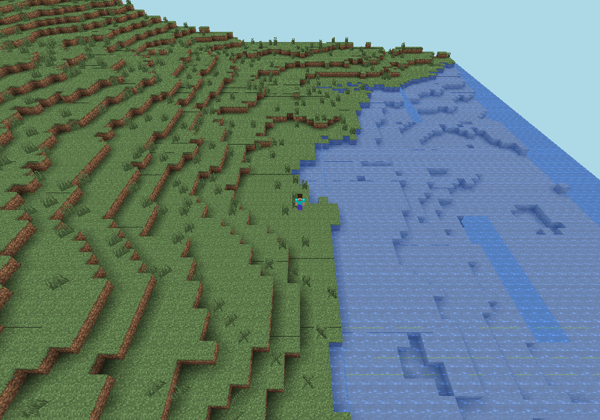

The companion tells how to run the example:
[LPS2 in detail, §14](introducing-lps2-technical.md#14-minecraft-running-the-example).

## 22. Industrial control, still on paper

Small special computers operate factories, pipelines and power stations. Their
name is programmable logic controllers. Such a controller is equal to the Minecraft
controller. It reads its sensors and moves its valves and motors many times each
second. It keeps a pressure stable, or a motor at the correct speed. People know
these controllers well, and nobody wants to replace them.

The plan proposes a part that is equal to the Minecraft supervisor. This part is an
LPS program that runs together with the controllers that exist now. It decides what
must occur next. It uses constraints to refuse the commands that must never be
given. An example of such a command: never open this valve while that pump runs.
The supervisor does not change the controllers.

No code for this exists now. The part that is nearest to ready is that supervisor.
It needs nothing that LPS2 does not already have: sessions that do not stop, and
channels that limit who can send what. A later step of the plan is to write LPS
programs in the language of such controllers. The tools for a first demonstration
are selected
([LPS2 in detail, §15](introducing-lps2-technical.md#15-industrial-control-the-named-tools)).

---

# Part six — where things stand

## 23. What is not there yet

- **The planner is not always fast, and not always the shortest.** For one of the
  standard PDDL test problems, the search continued after forty minutes. For a
  different problem, the fast search finds a plan of 15 steps, but a plan of 11
  steps is possible. The planner causes this limit, not the translation.
- **Old drawings on a dark background.** The editor has a dark theme. Some examples
  of LPS1 draw black text, because they expected a white page. To solve the
  problem, change to the light theme.
- **One example of LPS1 runs more slowly on LPS2**, by a factor of 2.4. All the
  other examples run faster.
- **Industrial control** is still only a plan on paper (§22).
- **LPS2 cannot read the languages of some other systems yet**: Jason (a language
  for agents), DECLARE and BPMN (languages for business processes), and behaviour
  trees (which robots and game characters use).

The companion gives the list of the other technical gaps
([LPS2 in detail, §18](introducing-lps2-technical.md#18-known-gaps-in-detail)).

## 24. Where to start

The fastest way is the editor. Do these steps:

1. Open the start page.
2. Select an example from the folder of starting examples.
3. Click **Run**.

The wolf, goat and cabbage puzzle is a good first example. It states the puzzle,
but it does not give the solution (§5).

Then read these documents:

- **[Learning LPS](../tutorials/lps-tutorial.md)**: how to write LPS programs,
  from a program of two lines to sessions that do not stop.
- **[Using the editor](../guide/ide.md)**: the editor, one part at a time, with a
  "how do I …" section.
- **[Glossary](../reference/glossary.md)**: each term that these documents use.
- **[A summary in two pages](abstract.md)**: for a person who must decide whether
  to read these documents.
- **[Language reference](../reference/lps.md)**: each construct of the language.
- **[Logical English for LPS](../reference/le-for-lps.md)**: LPS programs in
  English.
- **[LPS2 in detail](introducing-lps2-technical.md)**: the technical companion to
  this tour.
