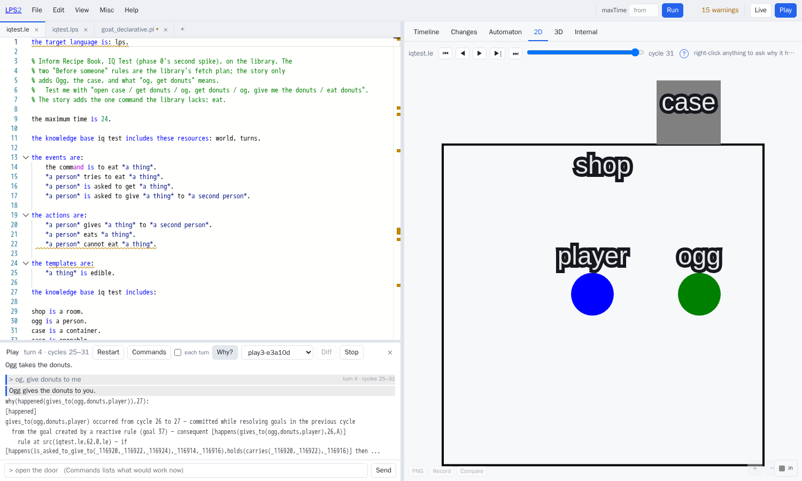
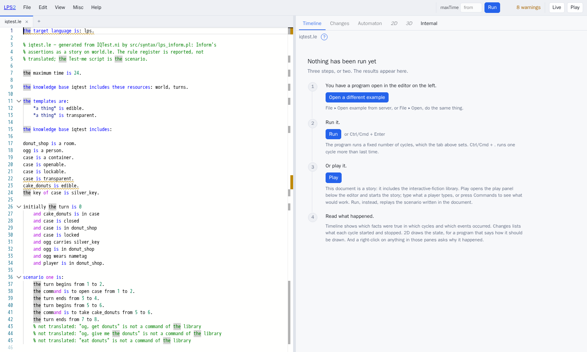
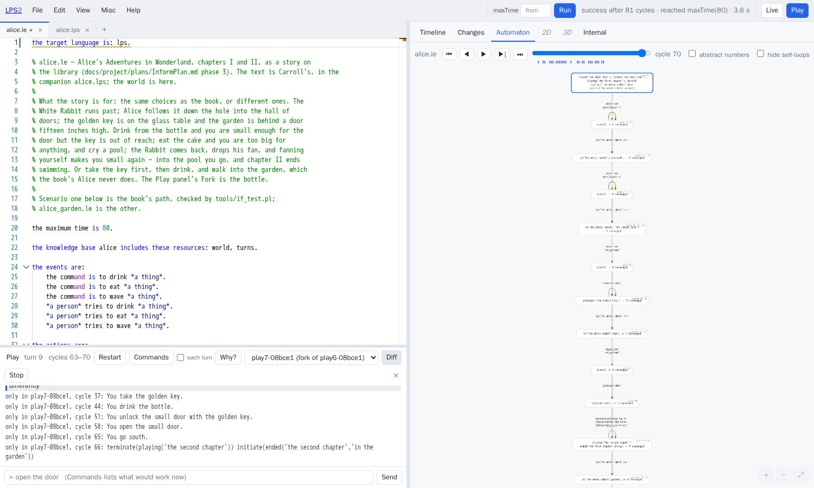
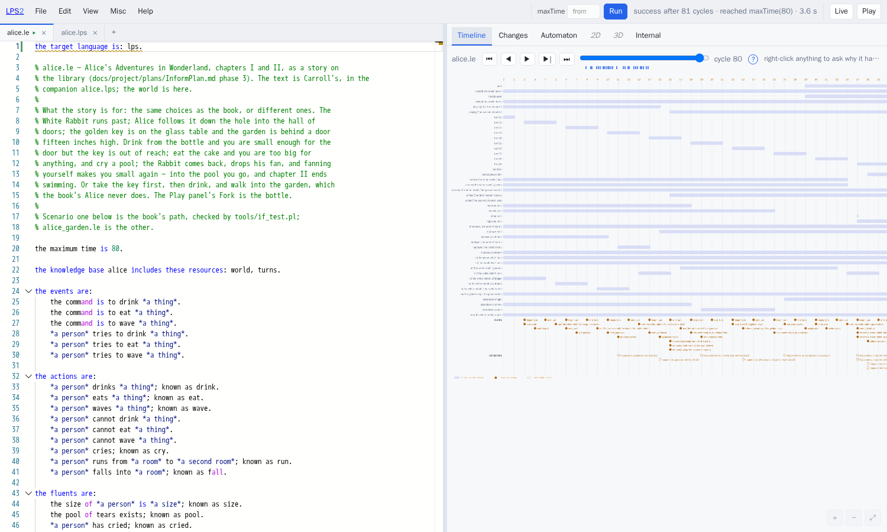
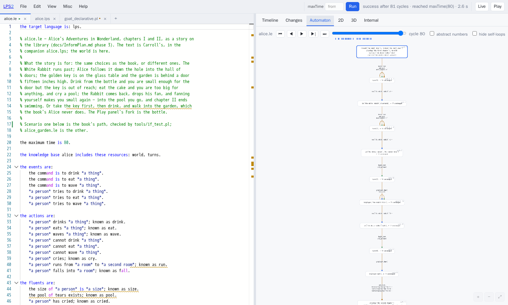
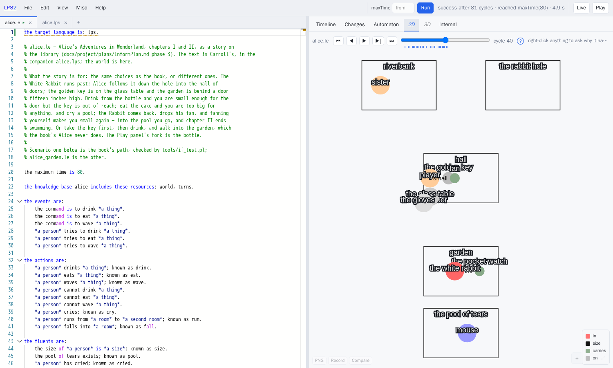
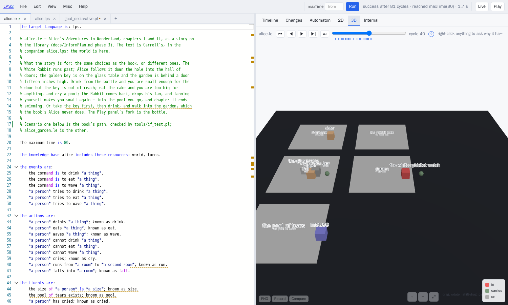
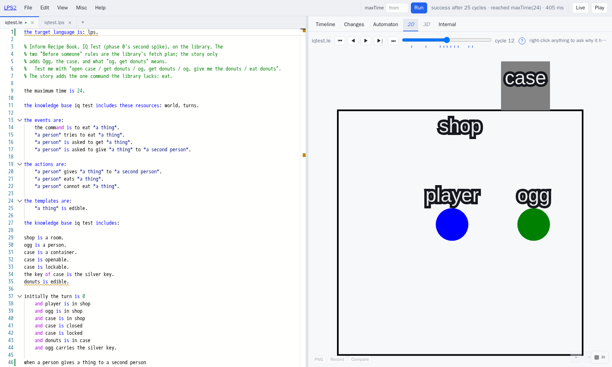
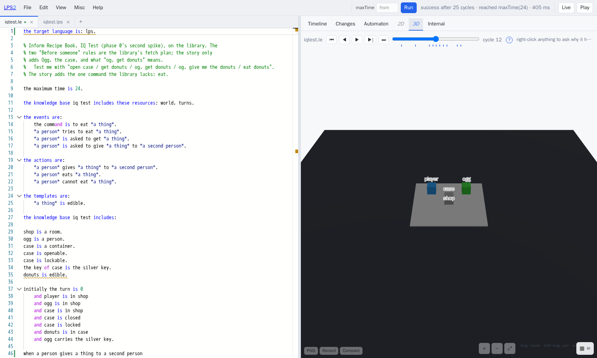

# LPS for Inform users

*Kind: tutorial · Audience: Inform 7 authors · Status: current (2026-09-08)*

This guide is for a person who writes interactive fiction in Inform 7. Interactive
fiction is a story that a player reads and controls with typed commands. The guide
tells you what LPS (Logic Production System) does with such a story. It tells you
which part of Inform agrees with which part of LPS. It tells you where the examples
are and how to run them. It also tells you where the capabilities of the two systems
are different, and what the current limits are. Two worked examples give most of the
details: Inform's own *IQ Test* recipe, and *Alice's Adventures in Wonderland*
forked at the bottle. The script `tools/doc_shots.cjs` made the pictures from the
running system.

Two cautions apply to the comparison. Inform 7 is a mature system. It has a large
standard library, a body of published work, and a parser. The parser is the part
that reads what the player types and finds what it means. The Inform parser has
improved during many decades. This guide compares Inform with a small library on top
of a general rule engine. The statements below are about how each system works, not
about how much each system covers. §8 gives a list of what is missing.

The second caution is about the tests. The tests compare the stories with Inform's
transcripts. A transcript is the record of a game: the commands and the replies. The
tests compare sequences of events, not printed text. Thus "the story replays" means
that the same actions occur at the same turns. It does not mean that the output has
the same words.

The document `docs/project/plans/InformPlan.md` gives the reasons for the design. It
also tells why LPS is an engine for interactive fiction, and not a translator into
Inform or out of Inform. This document tells you how to use LPS.

## 1. The two systems in one table

| | Inform 7 | LPS with Logical English |
|---|---|---|
| A story is | assertions that make a world, plus rules in approximately 340 rulebooks | a Logical English document that includes a library and adds its world and its rules |
| The world | kinds, objects, properties and relations, compiled to predicate calculus (a form of logic) | facts, which do not change with time, and fluents, which change with time. English templates state them |
| State change | `now the door is open`, which removes the old state | causal laws: `when X opens Y then it is not the case that Y is closed`. The engine solves the frame problem (what stays the same after an action) |
| Time | turns, a clock, `in four turns from now`, counters for the past | cycles that are explicit, with the full history kept. The turn is an optional layer (`turns.le`): a group of cycles. Every-turn rules and scheduled events use the turn |
| Preconditions | `Check` rules, each with a message | constraints of the form `it must not be true that …`. The refusal message comes from the constraint |
| Exceptions | `Instead`, `Before`, `After`, in an order that four sorting laws give | each rule fires. A constraint, not an order of precedence, settles a conflict |
| Characters | `every turn` rules and `try the person asked …` | reactive rules as goals that stay. A plan is a composite event that the engine expands |
| The parser | `Understand` lines and a kit | the command templates of the story are the grammar. Short forms (`x`, `i`, `n`) are part of the system |
| Output | `say` with substitutions, `report` rules | the system writes actions through their templates, or through a `narrate/2` clause in a companion file |
| Debugging | `actions`, `rules`, `scenes` commands | `why` and `why not` on each line of the transcript; a timeline; a state-transition diagram |
| What-if | UNDO | fork a game and compare the two games (diff) |

The largest difference for how you write a story is this: **a command is a `try`,
not an obligation.** In LPS, the part of a reactive rule after `then` is a goal. The
engine must satisfy that goal. If the engine cannot satisfy a goal, the run stops.
Thus `the command is to open X` becomes `player tries to open X`. That is a composite
event. Its first clause is the action, and its second clause is a refusal. When a
precondition refuses the action, the engine uses the second clause, the refusal.

The refusal contains the constraint that failed. The narrator tells the player about
that constraint. The library gives the pair of clauses for each standard command. A
story must give the pair of clauses for each command that the story adds (§4).

## 2. What each Inform construct becomes

| You write in Inform | You write in Logical English |
|---|---|
| `The Kitchen is a room.` | `kitchen is a room.` |
| `The oak door is a locked door. It is east of the Hall and west of the Study.` | `the oak door is a door.` `the oak door leads east from hall to study.` and, in `initially`, `the oak door is closed and the oak door is locked` |
| `Ogg is a man in the Donut Shop.` | `ogg is a person.` and `initially ogg is in donut_shop` |
| `The case contains some cake donuts.` | `initially donuts is in case` |
| `The matching key of the case is a silver key.` | `the key of case is the silver key.` |
| `Carry out eating: now the player is replete.` | `when a person eats a thing then it is not the case that the person is hungry.` |
| `Check eating something when the player is not hungry: say "…"` | `it must not be true that a person eats a thing from a first time to a second time and it is not the case that the person is hungry at the first time.` You do not write a message. The narrator makes one from the constraint (§4) |
| `Every turn when the player is hungry: say "…"` | `if the turn ends from a first time to a second time and player is hungry at the second time then player complains from the second time to a third time.` |
| `Hunger resumes in the satisfaction period of the noun from now.` | a fluent that names the turn when the event must occur, and a rule on `the turn ends` that fires when `the turn is` that number |
| `Starting ends roundly when the player carries the ball.` | `if starting is playing at a time and player carries ball at the time then terminate starting is playing … and initiate starting has ended roundly …` |
| `Before someone taking something in a closed container: try the person asked opening the container.` | a composite event: `a person fetches a thing … if the thing is in a container … and the person opens up the container … and the person takes the thing …`. The library gives this composite event |
| `Understand "photograph [someone]" as photographing.` | declare the event `the command is to photograph *a person*`. The template is the grammar |
| `say "Taken."` | nothing, or `narrate(take(player, X), "Taken.")` in the companion file |
| `Test me with "n / s / e / w".` | a `scenario` of `the command is to go north from 1 to 2.` lines, or play the story |

Logical English has two conventions that Inform does not have:

- **One condition on each line, with `and` first.** Logical English reads two
  conditions on one line as one sentence. People who come from Inform frequently
  make this error.
- **A name is a word, or a phrase that starts with `the`.** Examples are `hall`,
  `bottle`, `the oak door` and `the silver key`. Logical English reads `the oak door`
  as the name of one specific thing. The exception is when an earlier part of the
  same sentence introduced `an oak door`. The player types `door` or `key`. The
  narrator prints the name as you wrote it.

## 3. Where the examples are, and how to run them

All the examples are in `examples/if/`:

| file | what |
|---|---|
| `world.le` | the library: a subset of the physical world model of Inform, approximately twelve actions with preconditions and effects, scenes, and a fetch plan |
| `turns.le` | the clock: `the turn begins`, `the turn ends`, `the turn is N`. A story can include this layer or not |
| `implicit_connections.le`, `nothing_as_term.le`, `negated_rp.le`, `npc_going.le`, `regarding.le`, `scene.le` | six of the test cases of Inform, each with its `Test me with` script |
| `iqtest.le`, `boston_cream.le`, `mre.le` | three examples from the Recipe Book: characters that try to reach goals, and future events |
| `doors.le` | a door, written by hand from *Writing with Inform* §3.12 |
| `alice.le`, `alice.lps`, `alice_garden.le` | Alice, chapters I and II, and the path that the Alice of the book does not take |
| `alice_pure_lps.le` | Alice without the clock: the same states from causal rules only (§6b) |
| `inform/*.ni` | eleven Inform sources, word for word, for the front end of §5. The front end is the part that reads Inform sources |
| `expected/` | the event sequences that the tests compare with the stories. The sequences come from the ideal transcripts of Inform |

You must have LE2 in a folder next to the folder that contains LPS2. LE2 is the
compiler for LE (Logical English). Each command below assumes
`LPS_LE2_LIB=/LogicalEnglish2`.

```sh
./lps play examples/if/iqtest.le           # play it on the terminal: type; `why`; `fork`; `diff`; `quit`
./lps run  examples/if/iqtest.le           # replay its Test-me script and print the trace
./lps ide                                  # then open the story in the browser and press Play
```

The tests:

```sh
./myswipl.sh -q -g "consult('tools/if_test.pl')"   -g "if_test:main"   -t halt   # 13 stories: each replay's event sequence against the one read from Inform's transcript
./myswipl.sh -q -g "consult('tools/play_test.pl')" -g "play_test:main" -t halt   # 18 things a player does
tools/inform_test.sh                                                              # 11 Inform sources translate and run
```

The IDE (integrated development environment) is the editor and the panels around
the editor. In the IDE, **File ▸ Open example** shows the stories under *interactive
fiction* and *Inform 7*. To play a story, do these steps:

1. Open a story.
2. Click **Play** in the top bar.
3. Type a command.

**What to type.** The verbs are the command templates of the story. The library
gives these commands: `look`, `examine X`, `inventory`, `wait`, `take X`, `drop X`,
`put X in Y`, `put X on Y`, `open X`, `close X`, `lock X with Y`, `unlock X with Y`,
`go north` or `n`, `enter X`, `exit`. You can also type an order to a character
(`og, get donuts`). You can type each command that the story declares, for example
`drink`, `eat` and `wave` in Alice.

**Commands** in the panel, or `commands` on the terminal, shows a list. The list
contains the commands that can succeed from the current state. The list uses the
words that the player types. Click a command, and the game runs it. The list comes
from the constraints of the story. Thus the list changes with the situation as much
as those constraints do. For example, in the hall, the list contains
`take the golden key` while Alice has her usual size. The list contains
`unlock the small door with the golden key` only when she carries the key and is
small.

The Standard Rules of Inform have nothing equivalent to this list. In Inform, the
check rules of an action run only when the action occurs. Thus an author must write
such a list for each story separately. In LPS, the cost of the list is small. The
game examines a command of the player: it tries the preconditions of the story
against the state. Only an order to a character is tried on a copy of the game,
because the plan of a character has more than one step. Tick **each turn**, next to
Commands, and the game makes the list again after each turn.

The panel can send a line that the parser does not understand to a language model.
Do these steps first:

1. Select **Misc ▸ API keys**.
2. Set an API key.

An API (application programming interface) is the method that one program uses to
ask another program for something. The key is the password that identifies you to
the service of the model. The panel then sends to the model the line and the list of
commands that the story can accept. The model selects one command (*I take that as:
go west*), or no command (*I really don't understand that*).

The parser itself stays deterministic. Deterministic means that the same line always
gives the same result. The model only selects from the sentences of the parser. The
selection of the model can be incorrect, as any guess of this type can be.

**The panes follow the game.** After each turn, the Timeline, Changes and Automaton
panes and the 2D and 3D panes show the game until that point. The slider moves
forward and back through the game. The transcript records the turns. Each line that
you typed shows its turn number and the cycles of that turn. Click a cycle in the
Timeline, and the transcript marks the turn that contains that cycle. Click the line
of a turn, and the panes go to the end of that turn. Click a thing in the 2D or 3D
picture, and the transcript marks the turn in which that thing last changed, as of
the cycle of the slider. The panel also tells which fluents changed.

**A note about `; known as`.** This mark appears after some templates in the stories
below (`*a person* eats *a thing*; known as eat`). `; known as` is not a synonym.
(Logical English has `; synonym` for synonyms.) `; known as` sets the Prolog name of
the template, `eat/2` here. Without the mark, LE2 makes the name from the words
(`eats/2`, or `the_command_is_to_eat/1` for a command).

The `; known as` mark is optional. Without the mark, a story plays, its Commands
list operates, and the system explains its refusals. The mark is necessary where
something outside the English uses the name of the predicate. One example is a
companion `.lps` file of narration and pictures. (`alice.lps` uses terms such as
`take(player, 'the golden key')`.) Another example is the labels on the Timeline and
the Automaton, which show the Prolog name.

The commands of a story, its `tries to` composites and its refusals do not need the
mark. The reason is that the player connects a refusal to the refused action
through the composite event, not through the name. The library declares a name for
each thing that the library defines. Thus a story receives those names from the
library, and writes `; known as` only for its own verbs.

## 4. Worked example: Inform's *IQ Test*

The *IQ Test* of the Recipe Book introduces Ogg, "a person who will unlock and open a
container when the player tells him to get something inside". This is the Inform
source:

```
The Donut Shop is a room. Ogg is a man in the Donut Shop.
The Donut Shop contains a transparent closed openable locked lockable container
called a case. The case contains some cake donuts. The donuts are edible.
The matching key of the case is a silver key. The silver key is carried by Ogg.

A persuasion rule for asking someone to try doing something: persuasion succeeds.

Before someone opening a locked thing (called the sealed chest):
    if the person asked is carrying the matching key of the sealed chest,
        try the person asked unlocking the sealed chest with the matching key;
    if the sealed chest is locked, stop the action.

Before someone taking something which is in a closed container (called the shut chest):
    try the person asked opening the shut chest;
    if the shut chest is closed, stop the action.

Test me with "open case / get donuts / og, get donuts / og, give me the donuts / eat donuts".
```

The same story is in `examples/if/iqtest.le`. The world has nine lines. The two
`Before someone` rules have no equivalent in the story, because the fetch plan of the
library covers the same case. The story includes the library and the clock. A story
can omit the clock layer (§6b):

```
the knowledge base iq test includes these resources: world, turns.

the events are:
    the command is to eat *a thing*.
    *a person* tries to eat *a thing*.
    *a person* is asked to get *a thing*.
    *a person* is asked to give *a thing* to *a second person*.

the actions are:
    *a person* gives *a thing* to *a second person*.
    *a person* eats *a thing*.
    *a person* cannot eat *a thing*.

the templates are:
    *a thing* is edible.

the knowledge base iq test includes:

shop is a room.
ogg is a person.
case is a container.
case is openable.
case is lockable.
the key of case is the silver key.
donuts is edible.

initially the turn is 0
    and player is in shop
    and ogg is in shop
    and case is in shop
    and case is closed
    and case is locked
    and donuts is in case
    and ogg carries the silver key.

when a person gives a thing to a second person
then it is not the case that the person carries the thing.

when a person gives a thing to a second person
then the second person carries the thing.

when a person eats a thing
then it is not the case that the person carries the thing.

it must not be true that
    a person eats a thing from a first time to a second time
    and it is not the case that the person carries the thing at the first time.

if a person is asked to get a thing from a first time to a second time
then the person fetches the thing from the second time to a third time.

if a person is asked to give a thing to a second person from a first time to a second time
    and the person carries the thing at the second time
then the person gives the thing to the second person from the second time to a third time.

if the command is to eat a thing from a first time to a second time
then player tries to eat the thing from the second time to a third time.

a person tries to eat a thing from a first time to a second time if
    the person eats the thing from the first time to the second time.

a person tries to eat a thing from a first time to a second time if
    the person cannot eat the thing from the first time to the second time.
```

The last three rules are the `try` pattern of §1. The story writes this pattern for
the one command that the library does not have. The library gives the remaining
parts: opening, taking, orders, and the plan that Ogg follows.

This is the result when you play the story with the test script of Inform:

```
> open case
You can't open the case: the case is locked.
> get donuts
You can't take the donuts: you cannot reach the donuts.
> og, get donuts
Ogg unlocks the case with the silver key.
Ogg opens the case.
Ogg takes the donuts.
> og, give donuts to me
Ogg gives the donuts to you.
> eat donuts
You eat the donuts.
```

The story does not write the two refusal messages, and the library does not write
them. When the constraint refuses `open`, the engine uses the refusal. Then the
narrator asks the engine *why not*. The denial names `the case is locked`, and that
phrase becomes the message. The words are general. If a story must have a specific
sentence, the story gives that sentence in the companion file (§6 has an example).

The three actions of Ogg come from the fetch plan of the library, which the engine
expands. The case is closed, thus Ogg must open the case first. The case is locked,
thus Ogg must unlock it first. Ogg carries the key, thus he can unlock the case.
**Why?** asks the engine about the last turn:



The answer names the rule and the composite event that the engine was resolving. It
also names the sentence of the story that is the source of the rule. Right-click a
thing in the Timeline or in the Changes pane to ask the same question about a
scripted run.

**Ask on the terminal.** Use `./lps explain` to ask the same questions about the
scripted run of the story. You do not have to play the story. This command asks about
the refused `open` at the first turn:

```sh
./lps explain examples/if/iqtest.le --ask "why_not(happened(open(player, case)), 3)"
```
```
[blocked_by_denial]
open(player,case) did not occur at cycle 3
  a denial blocked open(player,case) — false [happens(open(player,case),2,3),holds(locked(case),2)]
```

The answer above is the constraint from the library, together with the fluent that
made the constraint true: the case was locked at cycle 2. The refusal message comes
from that constraint. This command asks about the refused `get donuts` at the second
turn:

```sh
./lps explain examples/if/iqtest.le --ask "why_not(happened(take(player, donuts)), 7)"
```
```
[blocked_by_denial]
take(player,donuts) did not occur at cycle 7
  a denial blocked take(player,donuts) — false [happens(take(player,donuts),6,7),holds(not(reachable(player,donuts)),6)]
```

`reachable` is the intensional fluent of the library. An intensional fluent is a
fluent that rules calculate from other fluents. The donuts are in a closed case,
thus nothing in the room can reach them. This command asks why Ogg unlocked the case
at the third turn, although nobody told him to do it:

```sh
./lps explain examples/if/iqtest.le --ask "why(happened(unlock(ogg, case, 'the silver key')), 11)"
```
```
[happened]
unlock(ogg,case,'the silver key') occurred from cycle 10 to 11 — committed while resolving goals in the previous cycle
  while resolving the composite event open_up(ogg,case) — from 10 to 12
  while resolving the composite event fetch(ogg,donuts) — from 10 to 13
  from the goal created by a reactive rule (goal 7) — consequent [happens(fetch(ogg,donuts),10,A)]
    rule at src(examples/if/iqtest.le,59,0,le) — if [happens(is_asked_to_get(_1498398,_1498400),_1498392,_1498394)] then ...
```

Read the answer from the bottom to the top. The order to get the donuts made a goal.
`fetch` is the plan of the library to get a thing. `open_up` opens a locked case. To
unlock the case is the first step of `open_up`. The line number points to this
sentence of the story:
`if a person is asked to get a thing … then the person fetches the thing …`.
In Inform, you get the same information when you read the `Before someone` rules
and run `rules on`. `rules on` shows the rules that fired, but it does not connect
those rules to the goal that caused them.

## 5. Bringing an Inform source across

`./lps inform` reads an Inform 7 source. It writes the Logical English story that the
*assertions* of the source make. The command does not translate the *rules* of the
source, and it does not make an approximation of them. It reports each rule, sentence
by sentence, as a diagnostic. A diagnostic is a message that tells what the command
could not translate.

```sh
./lps inform examples/if/inform/IQTest.ni                    # print the story
./lps inform examples/if/inform/IQTest.ni --out build/story  # write it beside a copy of the library
./lps play   examples/if/inform/NegatedRP.ni                 # or play the source directly
```

In the IDE, the same thing occurs when you open a `.ni` file. Open the file with
**File ▸ Open example from server…**, or from your computer with **File ▸ Open…**:



These parts of the source went into the story: the room, Ogg, the case with its
properties and its key, the donuts, the initial positions, and the first two commands
of the test script. Some parts did not go into the story. The comments at the bottom
and the diagnostics give a list of these parts:

- `og, get donuts`, because the library has no such command.
- `eat donuts`, because the story must add this verb.
- The two `Before someone` rules.
- The persuasion rule.
- The block-giving rule, which the source does not list.

The imported story is a world without rules. Before the story can play, you must
add by hand the eleven lines of §4 that tell what `og, get donuts` means.

The front end reads these constructs:

- Rooms.
- Kinds (built-in kinds, or kinds declared with `is a kind of`).
- Properties.
- `contains`, `in`/`on`, `here` and `carried by`.
- The map in its different phrasings, which include `West of the Passage is nowhere`
  (no path in that direction).
- Doors with two sides.
- Matching keys.
- Descriptions.
- `Test me with`.

The front end applies the defaults of Inform. A door is closed if the source does not
say otherwise. The player starts in the first room. A connection goes in the two
directions, unless the other direction is `nowhere`. `It` is the last thing that the
source declared.

The front end does not read scenes, conditions (`… when …`), tables, properties and
values. It reports them. The front end keeps the text substitutions in a description
(`[if …]`, `[a list of …]`) as they are, and reports them. The reason is that only
the rules of the story can calculate what they must say.

The converted story has the name of its source with `_ni` added (`iqtest_ni.le`).
Thus the converted story never has the same name as the hand-written `iqtest.le`. In
`tools/inform_test.sh`, eleven of the programs of Inform go through the front end.
The test compares each program with its initial state, which a person read by hand
from that program. The test also compares the programs that have no rules of their
own with the transcripts. Eleven programs are a small sample of the assertion syntax
of Inform. Sources outside that sample will use phrasings that the front end does not
know.

## 6. Worked example: Alice, forked at the bottle

`examples/if/alice.le` contains chapters I and II. It has these parts:

- the riverbank and the rabbit hole;
- the hall of doors, with the golden key on the glass table, and the garden behind a
  door fifteen inches high;
- a size with three values;
- a pool of tears that starts to exist during the story;
- the White Rabbit on a route, with a return for the fan;
- two chapters as scenes.

The words of Carroll are in `alice.lps`, the companion file.

Three constructions in the story are important.

**A character with a route.** The timetable of the Rabbit is four facts and one
rule:

```
the rabbit runs from offstage to riverbank.
the rabbit runs from riverbank to the rabbit hole.
the rabbit runs from the rabbit hole to hall.
the rabbit runs from hall to garden.

if the turn ends from a first time to a second time
    and the white rabbit is in a room at the second time
    and the rabbit runs from the room to a second room
then the white rabbit runs from the room to the second room from the second time to a third time.
```

The Rabbit appears when it runs from `offstage` to the riverbank. Inform does the
same with `now the White Rabbit is in the Hall`. A character who is not yet in the
story did not need a new construct.

**A room that starts to exist.** A room is reachable only when a fluent is true:

```
down from hall leads to the pool of tears at a time if
    the pool of tears exists at the time.
```

The sentence above is a clause that the story adds to the `leads` fluent of the
library. The map is a fluent like all other fluents, and a story can add clauses to
the map.

**A constraint instead of an `Instead`.** The door is fifteen inches high:

```
it must not be true that
    a person goes south from a first time to a second time
    and the person is in hall at the first time
    and it is not the case that the size of the person is small at the first time.
```

Inform writes `Instead of going south in the Hall when the player is not small:
say "…"`. Here there is no message and no precedence. The constraint refuses the
action, and the narrator tells why. The same constraint applies to the Rabbit. The
disadvantage is that the narrator chooses the words of the refusal, unless the
companion file gives a sentence.

Forking is the feature that has no direct equivalent in Inform. UNDO cancels one
turn. Here, two games start from a common turn and go in different directions, and
you can compare the two games. Do these steps:

1. Play until Alice is in the hall.
2. Select **Fork this game…**, the last item of the games picker.
3. In the fork, take the key first.
4. Drink.
5. Unlock the door.
6. Open the door.
7. Go south.

This is the path that the Alice of the book does not take. **Diff** shows what
occurred in this game and not in the other game. It uses the words of the story:



A session is a term that never changes after the system makes it. Thus a fork copies
a reference to the session, not the state itself. The two games then become
different, because you type different commands into each game. In the original game,
type `drink bottle` and then `take key`. The reply is *You cannot possibly reach it:
the key is on the table, far above your head*. That sentence is from Carroll, in the
companion file. The sentence replaces the line that the narrator would make if the
sentence was not there.

Click **Run** to run the scenario of the story. The panes then show the run, not the
prose. The Timeline shows the path of the scenario, fluent by fluent and turn by
turn:



The state-transition diagram agrees with what the Scenes index of Inform calls "the
map of time". The difference is that the editor makes the diagram from the run, not
from the declarations:



## 6a. Seeing the world, in two dimensions and three

An LPS program can tell how to draw its state. `display/2` gives a flat,
two-dimensional picture. `display3d/2` gives a three-dimensional scene, which the
three.js library draws. The 2D and 3D panes of the IDE then show the run again as a
picture. The cycle slider moves forward and back through the run. Right-click a
thing in the picture to ask why that thing is there. Inform has no equivalent,
because the world of Inform is prose.

You can write the clauses by hand, or you can let a language model make them. The
**Animate in 2D** and **Animate in 3D** buttons of the assistant ask a language
model for the clauses. The model uses the declarations and the initial state of the
program. The assistant then offers to put the result in the companion file. The
drawings below come from this procedure. The request went through the connection of
LPS2 to language models, to `openai/gpt-oss-120b` on Groq. A person examined the
result: the person ran the story and counted the drawn things. Then the clauses went
into `alice.lps` and `iqtest.lps`, with a header that tells their source.

**A caution.** A drawing from a model is not repeatable and is not authoritative. If
you ask again, you get a different layout, different colours, and different choices
of what to draw. The IQ Test drawing below puts the case outside the shop. That is
the geometry of the model: nothing in the story says it. The drawing is one answer
from many possible answers. It stays here because it shows the story well enough.

The logic does not change. `display/2` reads the state and never changes the state.
The tests that compare the stories with the transcripts of Inform do not examine the
pictures. You can edit the clauses by hand, or ask for them again.

Alice at cycle 40 of the path of the book: she is small and in the hall, the key is
on the table where she cannot reach it, and the Rabbit is in the garden:



The same cycle in three dimensions. The rooms are slabs. Each thing stands on the
slab of the room that contains it. A line shows `carries`:



The IQ Test at cycle 12, immediately after Ogg unlocked and opened the case on the
order of the player:





The system draws the pictures again each time from the clauses in the companion
files. The model makes the clauses again each time, differently each time.
`docs/user/guide/ide.md` tells what the panes can do. `docs/user/reference/lps.md`
§18 and §18a tell what the clauses can say.

## 6b. The same story without turns

`examples/if/alice_pure_lps.le` is Alice without the clock. The story includes
`world` but not `turns`. Thus nothing in the story can mention a turn, and the
program that runs the story adds no turn markers. In alice.le, three rules depend on
`the turn ends`. Here, each of these rules is written as the thing that caused it.
For example, the Rabbit runs on when Alice gets to the room that the Rabbit is in:

```
if the white rabbit is in a room at a time
    and player is in the room at the time
    and the rabbit runs from the room to a second room
then the white rabbit runs from the room to the second room from the time to a second time.
```

A huge Alice in the hall cries, because she is huge and in the hall. A small Alice
in a room with a pool falls into the pool. The trace test records the same fluent
transitions as alice.le, in the same order, and the story plays to the same end.

The speed of events is different. The first two runs of the Rabbit occur before the
first prompt. All the results of the cake occur in one group. The companion file is
alice.lps itself. Its words are attached to actions and never to a turn.

The comparison shows where the turn is necessary. The logic of a story does not need
the turn. Each thing that Alice schedules by the turn can be written as the thing
that causes it. A scripted replay needs the turn, because it must know where the
results of one command stop. (The scenario of the pure story leaves gaps between its
commands.) Rules that count commands also need the turn. Examples are `every turn`
and `in three turns from now` in Inform, which are based on turns by definition. A
story that has neither of these includes only the library.

## 7. Where the two systems differ in capability

LPS has these capabilities, and Inform does not have them:

- **Explanations.** You can use `why` on the terminal, **Why?** in the panel,
  `./lps explain` on a scripted run, or a right-click in a pane. The answer tells
  which rule, which composite event and which sentence. `why not` explains what did
  not occur. It tells which constraint refused the action, and which fluent made that
  constraint true (§4). `rules on` in Inform shows the rules when they fire, but it
  does not connect those rules to goals.
- **Pictures.** A flat picture and a three-dimensional scene of the state. You can
  move through them cycle by cycle. You can write their clauses by hand, or let a
  model make them (§6a).
- **A list of what can succeed now.** The list comes from the constraints of the
  story. For orders to characters, it comes from a test of the order on a copy of the
  game (§3).
- **Refusal messages from constraints.** A `Check` message in an Inform story is a
  sentence that a person wrote. Here, the default message is the constraint itself,
  in words. If a story must have specific words, the story writes those words in the
  companion file.
- **Forking.** What-if at any turn, with a comparison (diff) (§6).
- **Time as data.** The engine keeps the full history. `at the first time` in a rule
  is a question about that history, not a counter. A scheduled event is a fact about
  a future turn. A story can also operate without the turn layer (§6b).
- **Plans.** The goal of a character is a composite event, and the engine finds the
  steps. The fetch plan of Ogg is in the library. For the characters of your story,
  you write sentences that tell what they want.
- **The same file, scripted and played.** A `scenario` is a `Test me with`. The test
  replays each story against the transcripts of Inform, and a player plays the same
  file.
- **A live session.** A story is a program that waits for events. A thermostat and a
  Minecraft bot in LPS use the same idea. The Play panel is one of the things that
  can communicate with such a program.

Inform has these capabilities, and LPS does not have them at this time:

- **The Standard Rules.** Inform has approximately 340 rulebooks. The LPS library has
  approximately twelve actions. Light and darkness, the contents of containers in
  `look`, plurals, pronouns, supporters and containers with all their properties, and
  many other things are not there (§8).
- **The parser.** `Understand` lines, synonyms, disambiguation and the kit. The LPS
  parser compares the words of a name and the command templates. The LPS parser
  cannot give a synonym to a noun (§8).
- **Extensions and a body of work.** LPS has nothing equivalent to the extension
  library of Inform and its published stories. The examples here are the eleven test
  programs and Alice.
- **Distribution.** An Inform story compiles to a file that runs in all Z-machine or
  Glulx interpreters. To play a story here, you need the LPS system itself. For
  Logical English sources, you also need LE2.
- **Rules from Inform sources.** The front end translates only assertions (§5). You
  must write again by hand each `Before`, `Instead`, `Check` and `Every turn` rule.

## 8. Current limitations

- **One condition on each line.** §2 tells about this rule. People frequently make
  this error.
- **Your own commands need the `try` pair.** A story that declares
  `the command is to eat *a thing*` must also give the two clauses of
  `player tries to eat the thing` (§4). If it does not, the first refused `eat`
  stops the run.
- **A property change needs two laws.** `becomes` is applicable to
  `the reward is *an amount*`. For `the size of *a person* is *a size*`, terminate
  the old value and initiate the new value.
- **No `Understand` synonyms for nouns.** The parser finds `door` for `the oak door`
  and `og` for `ogg` from the words of the name. The parser does not find a name that
  has no word in common with the text that the player typed.
- **No list of contents in `look`** other than the things that are directly in the
  room. There is no light and darkness, there are no plurals and no pronouns. The
  library is a small subset of the Standard Rules, by design.
  `docs/project/plans/InformPlan.md` §7b tells what the library contains.
- **Exits show in the two directions.** A stated connection goes in the two
  directions, as in Inform. A story can close the other direction with
  `west from the passage goes nowhere.` (`West of the Passage is nowhere` in
  Inform). Some stories use a constraint to stop the return path (Alice cannot climb
  back up). Such a story still shows `up` as an exit.
- **Do not give an action the name of a predicate that Prolog already has.** For
  this reason, the library says `closes … ; known as shut`.
- **You must write the rules of an imported Inform story.** The front end did not
  translate the things that it reports as diagnostics (§5).
- **The transcript tests compare events, not text.** A story that "replays to the
  transcript of Inform" makes the same actions at the same turns. The tests do not
  compare the printed output.

## 9. Where to go next

- `examples/if/DETAILS.md`: each story, how the system drives it, and the
  conventions.
- `docs/project/plans/InformPlan.md`: the evaluation, the plan, and the results of
  each phase, with the numbers.
- `docs/user/guide/ide.md`: the Play panel and the other parts of the editor.
- `docs/user/tutorials/lps-tutorial.md` and `docs/user/reference/le-for-lps.md`: the
  language, and Logical English for that language, construct by construct.
